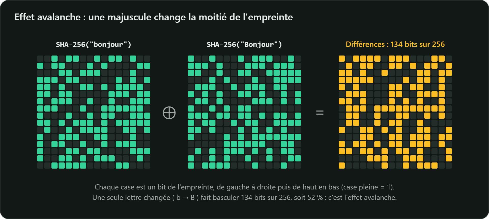

Une **fonction de hachage cryptographique** $H$ transforme un message de n'importe quelle taille en
une **empreinte** (*hash*, *digest*) de taille fixe : 256 bits pour SHA-256, soit 32 octets ou
64 caractères hexadécimaux.

$$H : \{0,1\}^* \longrightarrow \{0,1\}^{256}$$

## Essayez vous-même

```bash
printf 'bonjour' | openssl dgst -sha256
# SHA2-256(stdin)= 2cb4b1431b84ec15d35ed83bb927e27e8967d75f4bcd9cc4b25c8d879ae23e18

printf 'Bonjour' | openssl dgst -sha256
# SHA2-256(stdin)= 9172e8eec99f144f72eca9a568759580edadb2cfd154857f07e657569493bc44
```

Une seule majuscule change **toute** l'empreinte : c'est l'**effet avalanche**. Modifier un seul bit
de l'entrée inverse en moyenne la moitié des bits de sortie, sans aucun lien visible entre les deux
résultats.



> Utilisez `printf` plutôt que `echo` : `echo` ajoute un retour à la ligne, qui fait alors partie
> du message haché et donne une autre empreinte.

## En Java

```java
import java.nio.charset.StandardCharsets;
import java.security.MessageDigest;
import java.util.HexFormat;

byte[] empreinte = MessageDigest.getInstance("SHA-256")
        .digest("bonjour".getBytes(StandardCharsets.UTF_8));
System.out.println(HexFormat.of().formatHex(empreinte));
// 2cb4b1431b84ec15d35ed83bb927e27e8967d75f4bcd9cc4b25c8d879ae23e18
```

## À quoi sert une empreinte

| Usage | Exemple |
|---|---|
| Vérifier l'intégrité d'un fichier | fichiers `SHA256SUMS` des distributions Linux, `sha256sum -c` |
| Identifier un contenu | identifiants des commits Git, déduplication de fichiers |
| Brique d'autres mécanismes | signatures (on signe $H(m)$), HMAC, dérivation de clés, preuves de travail |

Sur cette plateforme, chaque document officiel fourni en PDF est vérifié par son SHA-256 avant
d'être publié : si un seul octet diffère de l'original, l'empreinte ne correspond plus.

## Ce qu'une empreinte n'est pas

- **Ce n'est pas un chiffrement** : il n'y a pas de clé, et on ne « déhache » pas.
- **Elle ne protège pas seule contre un attaquant actif** : s'il peut remplacer à la fois le fichier
  *et* l'empreinte publiée à côté, la vérification réussit. Il faut alors une clé secrète (HMAC,
  chapitre 3) ou une signature numérique.
- **Elle ne cache pas un petit ensemble de valeurs** : l'empreinte d'un code PIN à 4 chiffres se
  retrouve en 10 000 essais. C'est tout le problème des mots de passe, traité au chapitre 3.
