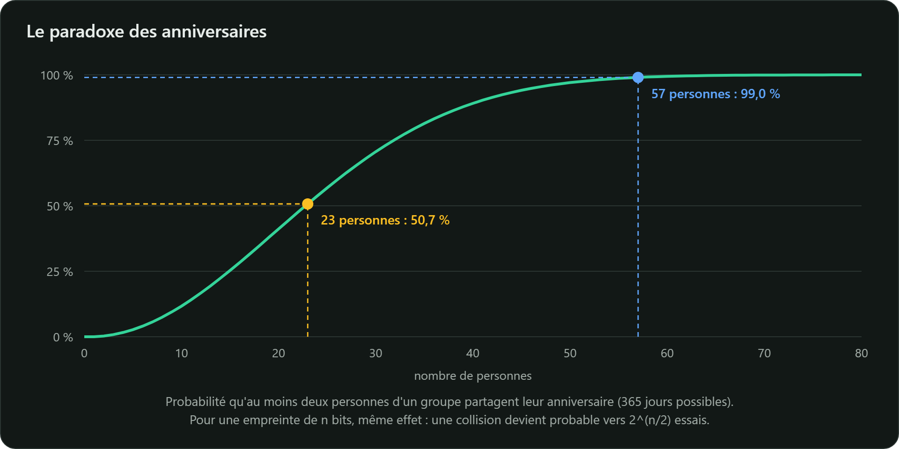

Pour un usage cryptographique, certaines recherches doivent être **calculatoirement impossibles**.
Avec une empreinte de $n$ bits :

| Propriété | Défi pour l'attaquant | Coût d'une attaque générique |
|---|---|---|
| Résistance à la **préimage** | étant donné $y$, trouver $m$ tel que $H(m) = y$ | $2^n$ |
| Résistance à la **seconde préimage** | étant donné $m$, trouver $m' \neq m$ tel que $H(m') = H(m)$ | $2^n$ |
| Résistance aux **collisions** | trouver **n'importe quelle** paire $m \neq m'$ telle que $H(m) = H(m')$ | $2^{n/2}$ |

Des collisions existent forcément (principe des tiroirs : une infinité de messages pour $2^{256}$
empreintes). La sécurité tient à ce qu'on ne sache pas en **trouver**.

## Le paradoxe des anniversaires

Dans une classe de 23 élèves, la probabilité que deux d'entre eux soient nés le même jour dépasse
50 %. C'est contre-intuitif parce qu'on ne cherche pas *une* date précise mais *n'importe quelle*
paire, et le nombre de paires croît comme le carré du nombre d'élèves.

De même, après environ $\sqrt{2^n} = 2^{n/2}$ empreintes calculées au hasard, une collision devient
probable. D'où la règle :

- une empreinte de 128 bits (MD5) n'offre au mieux que $2^{64}$ de résistance aux collisions,
  à la portée de moyens de calcul importants ;
- le guide de l'ANSSI sur les mécanismes cryptographiques (2026, règle *RègleHachage*) exige des
  empreintes d'**au moins 256 bits**, soit $2^{128}$ opérations pour une collision générique.

## Quand les attaques rattrapent les algorithmes

| Fonction | Taille | Statut |
|---|---|---|
| MD5 | 128 bits | collisions calculables en quelques secondes depuis les travaux de Wang et al. (2004) ; exploitées en 2012 par le logiciel espion Flame pour forger un certificat de signature de code Microsoft |
| SHA-1 | 160 bits | première collision publique en 2017 (*SHAttered*, environ $2^{63}$ calculs) ; collisions à préfixes choisis en 2020 (*SHA-1 is a Shambles*) |
| SHA-256, SHA-384, SHA-512 | 256 à 512 bits | aucune attaque pratique connue |
| SHA3-256, SHA3-512 | 256, 512 bits | aucune attaque pratique connue |

> **À retenir** : pour tout nouveau développement, SHA-256 (ou SHA-384, SHA-512, SHA3-256).
> Jamais MD5 ni SHA-1 pour un usage de sécurité.

## Une collision, est-ce vraiment grave ?

Oui, dès qu'on **signe** une empreinte. Si un attaquant fabrique deux documents de même empreinte,
l'un anodin ($m$) et l'autre malveillant ($m'$), puis fait signer $m$ par une autorité, la
signature est aussi valide pour $m'$. C'est exactement le scénario de Flame : un certificat
légitime obtenu pour un document, réutilisé pour signer un logiciel malveillant.

La résistance à la préimage, elle, protège les usages où l'on publie une empreinte en espérant
qu'on ne retrouvera pas l'entrée : engagements (*commitments*), dérivation de clés, etc.
