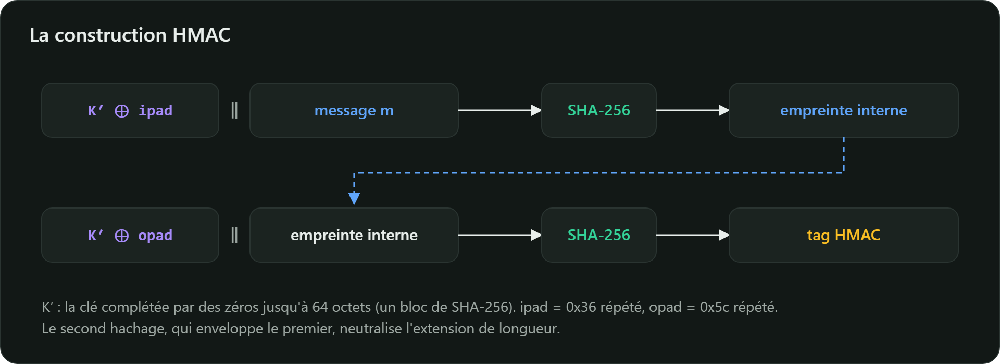

Un **MAC** (*Message Authentication Code*, code d'authentification de message) prouve qu'un
message a été produit par quelqu'un qui connaît une **clé secrète partagée**, et qu'il n'a pas été
modifié en route :

$$t = \text{MAC}_k(m) \qquad \text{vérification : } \text{MAC}_k(m) \overset{?}{=} t$$

## La construction HMAC

HMAC (RFC 2104, FIPS 198-1) transforme n'importe quelle fonction de hachage en MAC :

$$\text{HMAC}_k(m) = H\big((k' \oplus \text{opad}) \parallel H((k' \oplus \text{ipad}) \parallel m)\big)$$

- $k'$ : la clé complétée par des zéros jusqu'à la taille d'un bloc (64 octets pour SHA-256), ou
  d'abord hachée si elle est plus longue ;
- $\text{ipad}$ : l'octet `0x36` répété, $\text{opad}$ : l'octet `0x5c` répété.



Le hachage **externe** neutralise l'extension de longueur : même construit sur SHA-256, HMAC est
sûr. Il ne repose pas non plus sur la résistance aux collisions, ce qui explique que HMAC-SHA1 soit
encore toléré là où SHA-1 seul est banni.

```bash
printf 'bonjour' | openssl dgst -sha256 -hmac 'cle-secrete'
# SHA2-256(stdin)= c9493600cab6b69cdbecdeb1ff294abf03665c7b37e331c661d18826efec61df
```

```java
import java.security.MessageDigest;
import javax.crypto.Mac;
import javax.crypto.spec.SecretKeySpec;

Mac mac = Mac.getInstance("HmacSHA256");
mac.init(new SecretKeySpec(cle, "HmacSHA256"));   // clé aléatoire de 32 octets
byte[] tag = mac.doFinal(message);

// Vérification : comparaison en temps constant, jamais Arrays.equals
boolean valide = MessageDigest.isEqual(tag, tagRecu);
```

## Le piège de la comparaison

`Arrays.equals` s'arrête au premier octet différent. Le temps de réponse révèle alors combien
d'octets du tag sont justes, et un attaquant patient peut le reconstituer octet par octet : c'est
une **attaque temporelle**. `MessageDigest.isEqual` compare toujours tous les octets.

## HMAC dans la vraie vie

| Usage | Détail |
|---|---|
| Jetons JWT `HS256` | HMAC-SHA256 de l'en-tête et du contenu du jeton |
| TLS 1.3 | toutes les clés de session sont dérivées par HKDF, construit sur HMAC |
| Webhooks (GitHub, Stripe…) | chaque notification porte un HMAC-SHA256 calculé avec un secret partagé |
| Codes à usage unique TOTP (RFC 6238) | HMAC du compteur de temps, tronqué à 6 chiffres |

## MAC ou signature ?

Un MAC utilise une clé **partagée** : le destinataire pourrait lui-même fabriquer le tag. Un MAC
prouve donc l'origine au destinataire, mais ne prouve rien à un tiers : il n'offre pas de
**non-répudiation**. Une signature numérique, elle, utilise une clé **privée** que seul l'émetteur
détient.
