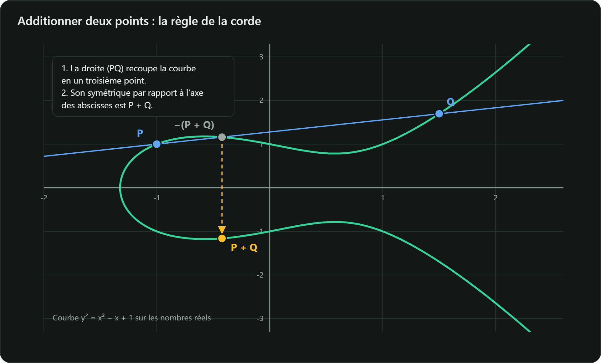

RSA repose sur la difficulté de factoriser. Les courbes elliptiques reposent sur un autre problème,
le **logarithme discret sur courbe elliptique** (ECDLP), bien plus difficile à taille égale :

| Sécurité visée | RSA / Diffie-Hellman classique | Courbe elliptique |
|---|---|---|
| 128 bits | 3072 bits | 256 bits |
| 192 bits | 7680 bits | 384 bits |
| 256 bits | 15 360 bits | 512 bits (P-521) |

(Équivalences du tableau 2 de la NIST SP 800-57 partie 1.)

## L'équation

Sur un corps fini $\mathbb{F}_p$ ($p$ premier, tous les calculs modulo $p$), une courbe elliptique
sous **forme de Weierstrass courte** est l'ensemble des points $(x, y)$ tels que

$$y^2 \equiv x^3 + ax + b \pmod p, \qquad \text{avec } 4a^3 + 27b^2 \not\equiv 0 \pmod p$$

auquel on ajoute un point spécial $\mathcal{O}$, le **point à l'infini**, qui joue le rôle de zéro.
La condition sur $4a^3 + 27b^2$ exclut les courbes « singulières » (avec un point de rebroussement
ou un croisement).

## Additionner deux points

Sur les réels, la règle est géométrique : la droite passant par $P$ et $Q$ recoupe la courbe en un
troisième point ; son symétrique par rapport à l'axe des abscisses est $P + Q$. Sur $\mathbb{F}_p$,
on conserve les mêmes formules, calculées modulo $p$ :

$$\lambda = \begin{cases} \dfrac{y_Q - y_P}{x_Q - x_P} & \text{si } P \neq Q \\[3mm] \dfrac{3x_P^2 + a}{2y_P} & \text{si } P = Q \text{ (doublement)} \end{cases}$$

$$x_R = \lambda^2 - x_P - x_Q, \qquad y_R = \lambda\,(x_P - x_R) - y_P$$

Cas particuliers : $P + \mathcal{O} = P$, et $P + (-P) = \mathcal{O}$, où $-(x, y) = (x, -y)$.

« Diviser » modulo $p$ signifie multiplier par l'**inverse modulaire**, que l'on calcule avec
l'algorithme d'Euclide étendu, ou avec le petit théorème de Fermat : $u^{-1} \equiv u^{p-2} \pmod p$.

Muni de cette addition, l'ensemble des points forme un **groupe commutatif**.

## Le problème difficile

On fixe un point de base $G$ d'ordre $n$ premier (le plus petit $n$ tel que $nG = \mathcal{O}$).
La **multiplication scalaire** consiste à additionner $G$ à lui-même $k$ fois :

$$Q = kG = \underbrace{G + G + \dots + G}_{k \text{ fois}}$$

- Calculer $Q$ à partir de $k$ est **rapide** grâce à la méthode « doublement et addition » :
  environ 256 doublements pour un $k$ de 256 bits.
- Retrouver $k$ à partir de $Q$ et $G$ est **infaisable** pour $n$ de 256 bits : le meilleur
  algorithme générique connu (rho de Pollard) coûte de l'ordre de $\sqrt{n} \approx 2^{128}$
  opérations.

$k$ sera la **clé privée** et $Q$ la **clé publique**.

## Les courbes utilisées en pratique

| Courbe | Taille | Où la rencontrer |
|---|---|---|
| P-256 (secp256r1) | 256 bits | certificats TLS, cartes à puce ; normalisée par le NIST (SP 800-186) |
| P-384 | 384 bits | usages à sécurité renforcée |
| Curve25519 | 255 bits | X25519 et Ed25519 : TLS 1.3, SSH, Signal, WireGuard |
| secp256k1 | 256 bits | Bitcoin, Ethereum |
| FRP256v1 | 256 bits | courbe publiée par l'ANSSI au Journal officiel du 16/10/2011 |

Le guide ANSSI des mécanismes cryptographiques impose des sous-groupes d'ordre au moins
**250 bits** (règle *RègleCourbeElliptiqueGFp*) : toutes les courbes de ce tableau conviennent.
