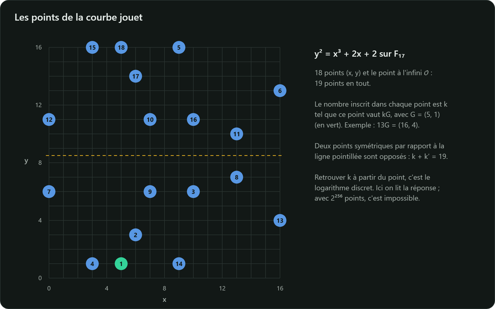

Prenons la petite courbe $E : y^2 = x^3 + 2x + 2$ sur $\mathbb{F}_{17}$ et le point $G = (5, 1)$.
Tous les calculs ci-dessous sont modulo 17.

**$G$ est-il sur la courbe ?** $\;1^2 = 1$ et $5^3 + 2 \cdot 5 + 2 = 137 = 8 \cdot 17 + 1 \equiv 1$. ✓

## Calcul de 2G (doublement)

$$\lambda = \frac{3 \cdot 5^2 + 2}{2 \cdot 1} = \frac{77}{2}$$

- $77 = 4 \cdot 17 + 9$, donc $77 \equiv 9$ ;
- l'inverse de 2 modulo 17 est 9, car $2 \cdot 9 = 18 \equiv 1$ ;
- $\lambda = 9 \cdot 9 = 81 = 4 \cdot 17 + 13 \equiv 13$.

$$x = 13^2 - 5 - 5 = 159 \equiv 6, \qquad y = 13 \cdot (5 - 6) - 1 = -14 \equiv 3$$

Donc $2G = (6, 3)$. Vérification : $3^2 = 9$ et $6^3 + 2 \cdot 6 + 2 = 230 = 13 \cdot 17 + 9$. ✓

## Calcul de 3G = G + 2G (addition)

$$\lambda = \frac{3 - 1}{6 - 5} = 2, \qquad x = 2^2 - 5 - 6 = -7 \equiv 10, \qquad y = 2 \cdot (5 - 10) - 1 = -11 \equiv 6$$

Donc $3G = (10, 6)$.

## Tous les multiples de G

| $k$ | $kG$ | $k$ | $kG$ |
|---|---|---|---|
| 1 | (5, 1) | 11 | (13, 10) |
| 2 | (6, 3) | 12 | (0, 11) |
| 3 | (10, 6) | 13 | (16, 4) |
| 4 | (3, 1) | 14 | (9, 1) |
| 5 | (9, 16) | 15 | (3, 16) |
| 6 | (16, 13) | 16 | (10, 11) |
| 7 | (0, 6) | 17 | (6, 14) |
| 8 | (13, 7) | 18 | (5, 16) |
| 9 | (7, 6) | 19 | $\mathcal{O}$ |
| 10 | (7, 11) | | |

La courbe compte 19 points : 18 points $(x, y)$ et $\mathcal{O}$. $G$ les parcourt tous : son
**ordre** est $n = 19$, un nombre premier. Observez la symétrie : $18G = -G = (5, -1) = (5, 16)$,
$17G = -2G = (6, 14)$, etc.



## Le logarithme discret, en miniature

Pour quel $k$ a-t-on $kG = (16, 4)$ ? Ici, un coup d'œil au tableau suffit : $k = 13$. Avec
$n \approx 2^{256}$, le tableau compterait de l'ordre de $10^{77}$ lignes, impossible à calculer
comme à stocker, et aucune méthode connue ne fait fondamentalement mieux que $2^{128}$ opérations
sur les courbes bien choisies.

## À vous de jouer

Ce programme Python reproduit le tableau. Changez de point de départ, vérifiez vos calculs à la
main, ou cherchez l'ordre d'autres points.

```python
p, a = 17, 2

def add(P, Q):
    if P is None: return Q                 # None représente le point à l'infini
    if Q is None: return P
    (x1, y1), (x2, y2) = P, Q
    if x1 == x2 and (y1 + y2) % p == 0:
        return None                        # P + (-P) = O
    if P == Q:
        l = (3 * x1 * x1 + a) * pow(2 * y1, -1, p) % p
    else:
        l = (y2 - y1) * pow(x2 - x1, -1, p) % p
    x3 = (l * l - x1 - x2) % p
    return (x3, (l * (x1 - x3) - y1) % p)

def mul(k, P):                             # doublement et addition
    R = None
    while k:
        if k & 1:
            R = add(R, P)
        P, k = add(P, P), k >> 1
    return R

G = (5, 1)
for k in range(1, 20):
    print(k, mul(k, G))
```
