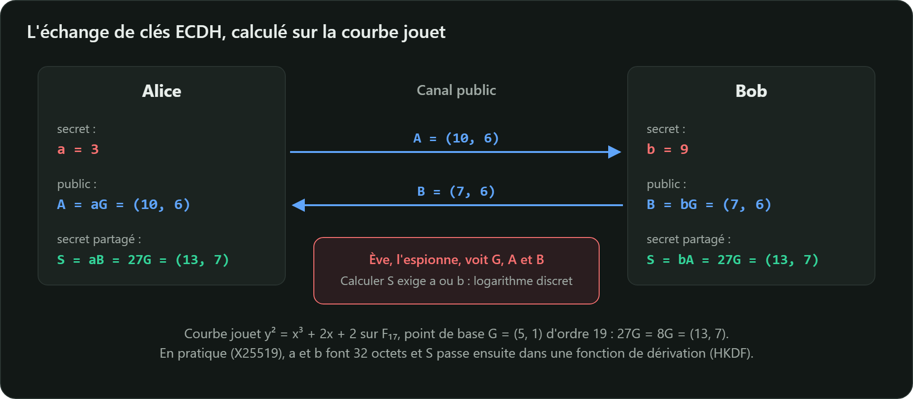

## Le principe de Diffie-Hellman sur courbe elliptique

Alice et Bob conviennent publiquement d'une courbe et d'un point $G$ d'ordre $n$.

| Alice | Canal public | Bob |
|---|---|---|
| choisit $a$ secret | | choisit $b$ secret |
| $A = aG$ | $A \longrightarrow$ | |
| | $\longleftarrow B$ | $B = bG$ |
| calcule $aB = abG$ | | calcule $bA = baG$ |

Les deux obtiennent le **même point** $S = abG$. Un espion voit $G$, $A$ et $B$ mais, sans $a$ ni
$b$, il devrait résoudre un logarithme discret pour calculer $S$.

## Sur notre petite courbe

Avec $G = (5, 1)$ sur $y^2 = x^3 + 2x + 2$ modulo 17 (ordre $n = 19$) :

- Alice choisit $a = 3$ et envoie $A = 3G = (10, 6)$ ;
- Bob choisit $b = 9$ et envoie $B = 9G = (7, 6)$ ;
- Alice calcule $3B = 27G$ ; comme $19G = \mathcal{O}$, $27G = 8G = (13, 7)$ ;
- Bob calcule $9A = 27G = (13, 7)$. Même secret. ✓



## Ne jamais utiliser le secret brut

Le point partagé n'est pas une suite d'octets uniformément aléatoire. On le passe toujours dans une
**fonction de dérivation de clés**, typiquement HKDF (RFC 5869), avec le contexte du protocole,
pour obtenir les clés symétriques :

$$k_{\text{AES}} = \text{HKDF}(\text{sel},\ x_S,\ \text{« contexte du protocole »})$$

## X25519 (RFC 7748)

X25519 est l'échange ECDH sur **Curve25519**, conçue par Daniel J. Bernstein en 2006 :

- clés privées et publiques de **32 octets** ;
- toute chaîne de 32 octets est acceptée comme clé publique : pas de vérification de point coûteuse
  ou oubliée ;
- calcul en temps constant par l'**échelle de Montgomery**, qui n'utilise que la coordonnée $x$ ;
- c'est l'échange de clés par défaut de TLS 1.3, SSH, Signal et WireGuard.

```bash
openssl genpkey -algorithm X25519 -out alice.key
openssl pkey -in alice.key -pubout -out alice.pub
openssl genpkey -algorithm X25519 -out bob.key
openssl pkey -in bob.key -pubout -out bob.pub

openssl pkeyutl -derive -inkey alice.key -peerkey bob.pub -out secret-alice.bin
openssl pkeyutl -derive -inkey bob.key -peerkey alice.pub -out secret-bob.bin
cmp secret-alice.bin secret-bob.bin && echo "même secret de 32 octets"
```

```java
// Java 11 et plus
KeyPairGenerator generateur = KeyPairGenerator.getInstance("X25519");
KeyPair alice = generateur.generateKeyPair();
KeyPair bob = generateur.generateKeyPair();

KeyAgreement accord = KeyAgreement.getInstance("X25519");
accord.init(alice.getPrivate());
accord.doPhase(bob.getPublic(), true);
byte[] secret = accord.generateSecret(); // 32 octets, à passer dans HKDF
```

## ECDH ne suffit pas seul

ECDH protège contre l'**écoute passive**, pas contre l'**homme du milieu** : Mallory peut
intercepter $A$ et $B$ et mener un échange séparé avec chacun. Il faut **authentifier** les clés
échangées, par une signature (leçons suivantes) adossée à un certificat (cours *PKI et certificats
X.509*).

Avec des clés **éphémères**, regénérées à chaque session (ECDHE), on obtient la **confidentialité
persistante** : voler plus tard la clé de signature d'un serveur ne permet pas de déchiffrer les
sessions enregistrées auparavant.
