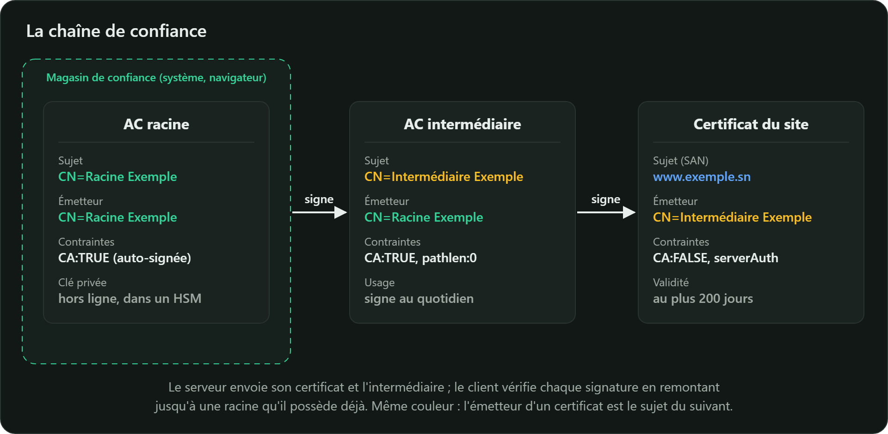

La cryptographie à clé publique résout le partage de clé… à condition d'avoir la **bonne** clé
publique. Si Mallory remplace la clé de votre banque par la sienne au moment où vous la recevez, tout
le reste fonctionne parfaitement : échange de clés, chiffrement, vérification de signature. Mais
avec Mallory.

## L'idée du certificat

Un **certificat** est un document **signé** par un tiers de confiance, l'**autorité de
certification** (AC), qui atteste en substance :

> « La clé publique `04:8a:3f:…` appartient à `www.exemple.sn`, du 1er mars au 30 mai. »

Pour vérifier la clé de n'importe quel site, il suffit alors de connaître à l'avance **une seule**
clé publique : celle de l'AC.

## La chaîne de confiance

- Les **AC racines** sont des **ancres de confiance** : quelques dizaines d'organismes, dont les
  certificats sont préinstallés dans les systèmes d'exploitation et les navigateurs après audit.
  Leur clé privée est conservée hors ligne, dans des boîtiers matériels sécurisés (HSM).
- Les **AC intermédiaires** signent au quotidien. Si l'une est compromise, on la révoque sans toucher
  à la racine.
- Le serveur envoie son certificat **et** les intermédiaires ; le client remonte la chaîne jusqu'à
  une racine qu'il connaît déjà.

## Une PKI, ce n'est pas que de la cryptographie

Une infrastructure à clés publiques réunit aussi :

- des **procédures d'enregistrement** : vérifier le contrôle du nom de domaine pour un certificat
  TLS, une pièce d'identité pour un certificat de personne ;
- des **politiques de certification** publiées et auditées : exigences du CA/Browser Forum pour le
  Web, règlement eIDAS pour les signatures électroniques en Europe ;
- des mécanismes de **révocation** et de **journalisation** (chapitre suivant).

La confiance ne vaut que ce que valent les AC. En 2011, l'intrusion chez l'AC néerlandaise
**DigiNotar** a permis d'émettre de faux certificats, notamment pour `*.google.com`, utilisés pour
intercepter les communications d'utilisateurs en Iran. Les navigateurs ont retiré sa racine et
l'entreprise a fait faillite dans le mois.

## D'autres modèles de confiance

- **Toile de confiance** (PGP) : chacun signe les clés des personnes qu'il a vérifiées.
- **TOFU** (*Trust On First Use*) : SSH mémorise la clé d'un serveur à la première connexion et
  alerte si elle change ensuite.
- **Épinglage** (*pinning*) : une application embarque la clé attendue. Robuste, mais délicat à
  faire évoluer lors d'un changement de clé.
