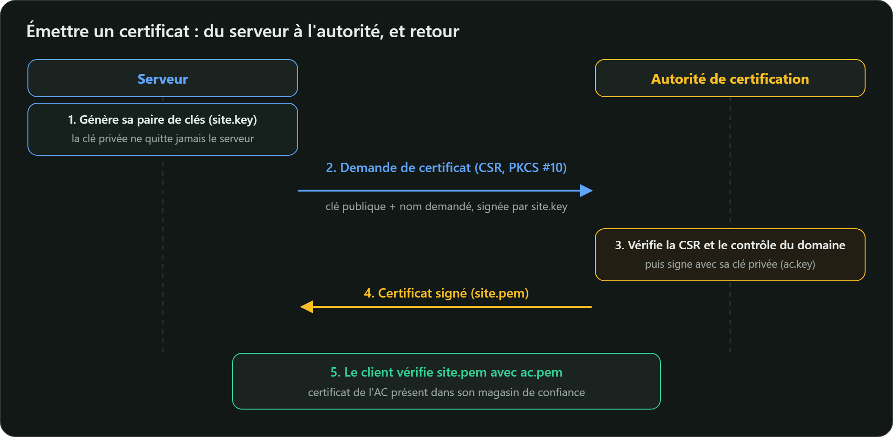

Pour un réseau interne, un laboratoire ou des tests, vous pouvez être votre propre autorité de
certification. Voici une AC racine et un certificat serveur en ECDSA P-256, avec OpenSSL 3. Toutes
les commandes de cette leçon ont été testées avec OpenSSL 3.5.



## 1. La clé et le certificat de l'AC racine

```bash
openssl genpkey -algorithm EC -pkeyopt ec_paramgen_curve:P-256 -out ac.key

openssl req -x509 -new -key ac.key -sha256 -days 3650 \
  -subj "/C=SN/O=Mon Labo/CN=Mon AC racine" \
  -addext "basicConstraints=critical,CA:TRUE" \
  -addext "keyUsage=critical,keyCertSign,cRLSign" \
  -out ac.pem
```

`-x509` produit directement un certificat **auto-signé** : l'émetteur et le sujet sont identiques.
`ac.key` est le bien le plus précieux de votre PKI : en production, cette clé vit dans un HSM,
hors ligne.

## 2. La demande de certificat (CSR) du serveur

Le serveur génère **sa propre** clé, qui ne quitte jamais la machine, et envoie à l'AC une demande
signée (*Certificate Signing Request*, format PKCS #10) :

```bash
openssl genpkey -algorithm EC -pkeyopt ec_paramgen_curve:P-256 -out site.key

openssl req -new -key site.key -subj "/CN=site.local" \
  -addext "subjectAltName=DNS:site.local,DNS:www.site.local" \
  -out site.csr
```

La CSR est signée avec `site.key` : l'AC vérifie ainsi que le demandeur possède bien la clé privée
correspondante.

## 3. L'AC signe

L'AC ne recopie pas aveuglément ce que demande la CSR : elle applique **ses** règles, décrites ici
dans un fichier `site.ext` :

```text
basicConstraints=CA:FALSE
keyUsage=critical,digitalSignature
extendedKeyUsage=serverAuth
subjectAltName=DNS:site.local,DNS:www.site.local
```

```bash
openssl x509 -req -in site.csr -CA ac.pem -CAkey ac.key -CAcreateserial \
  -days 90 -sha256 -extfile site.ext -out site.pem
```

## 4. Vérifier

```bash
openssl verify -CAfile ac.pem site.pem
# site.pem: OK

openssl x509 -in site.pem -noout -subject -issuer -dates \
  -ext subjectAltName,keyUsage,extendedKeyUsage,basicConstraints
```

Avec une autre AC, la vérification échoue :

```text
CN=site.local
error 20 at 0 depth lookup: unable to get local issuer certificate
error site.pem: verification failed
```

## 5. Faire confiance à son AC

Pour que navigateurs et outils acceptent `site.pem`, installez `ac.pem` dans le magasin de
confiance :

- Debian / Ubuntu : copiez-le en `/usr/local/share/ca-certificates/mon-ac.crt`, puis
  `sudo update-ca-certificates` ;
- Windows (en administrateur) : `certutil -addstore Root ac.pem` ;
- Java : `keytool -importcert -cacerts -file ac.pem -alias mon-ac`.

> ⚠️ Une AC racine installée peut signer un certificat pour **n'importe quel** domaine, y compris
> celui de votre banque. N'installez que les vôtres, et uniquement sur des machines que vous
> maîtrisez.

Pour des sites publics, utilisez une AC reconnue. **Let's Encrypt** délivre gratuitement des
certificats automatisés grâce au protocole **ACME** (RFC 8555), avec des clients comme `certbot`.
