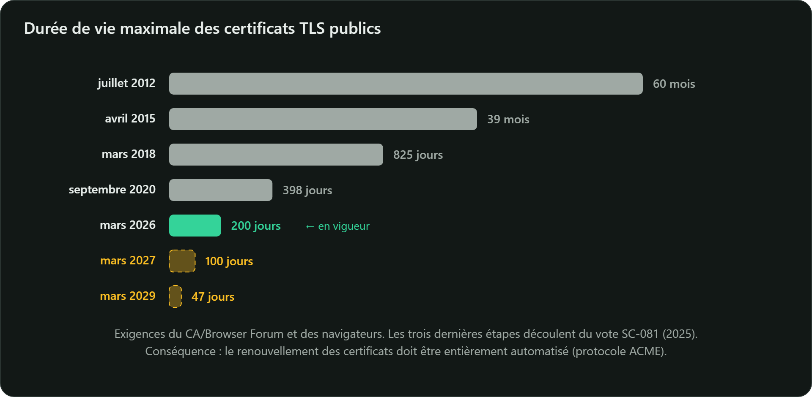

## La validation d'une chaîne (RFC 5280, § 6)

Pour chaque certificat de la chaîne, du serveur jusqu'à la racine, le client vérifie :

1. la **signature**, avec la clé publique du certificat de l'émetteur ;
2. la **période de validité**, d'où l'importance d'une horloge à l'heure ;
3. le **chaînage des noms** : l'`issuer` d'un certificat est le `subject` du suivant ;
4. que chaque émetteur est bien une AC (`basicConstraints CA:TRUE`, `keyUsage keyCertSign`) et
   respecte la longueur de chemin autorisée (`pathlen`) ;
5. les **contraintes de noms** et les **politiques**, s'il y en a ;
6. le **statut de révocation** ;
7. et pour TLS : le nom demandé figure dans le `subjectAltName`, et l'usage `serverAuth` est présent.

La chaîne doit aboutir à une **ancre de confiance**. Une seule erreur, et le navigateur affiche son
avertissement pleine page.

## Révoquer un certificat

Clé privée volée, serveur retiré, erreur d'émission : il faut pouvoir invalider un certificat avant
sa date d'expiration.

| Mécanisme | Principe | Limites |
|---|---|---|
| **CRL** (RFC 5280) | l'AC publie régulièrement la liste signée des numéros de série révoqués | listes parfois volumineuses, mises à jour périodiques |
| **OCSP** (RFC 6960) | le client interroge l'AC en temps réel sur un certificat donné | l'AC apprend quels sites vous visitez ; en cas de panne, les clients ignorent souvent l'erreur |
| **Agrafage OCSP** | le serveur joint lui-même une réponse OCSP récente | à configurer côté serveur |
| **Certificats de courte durée** | on laisse expirer rapidement plutôt que de révoquer | impose l'automatisation |

La tendance est nette. **Let's Encrypt** a abandonné OCSP en 2025 au profit des CRL. Et le
**CA/Browser Forum** a adopté en 2025 (vote SC-081) une réduction progressive de la durée maximale
des certificats TLS publics : 200 jours depuis mars 2026, 100 jours en mars 2027, puis **47 jours**
en mars 2029. Conclusion : automatisez le renouvellement (ACME).



## Certificate Transparency

Depuis 2018, Chrome exige que tout certificat TLS public soit inscrit dans des **journaux publics**
en ajout seul (*Certificate Transparency*, RFC 6962). Chaque propriétaire de domaine peut y
détecter un certificat émis à son insu, par exemple sur `https://crt.sh/?q=exemple.sn`.

## CAA : désigner les AC autorisées

Un enregistrement DNS **CAA** (RFC 8659) indique quelles AC ont le droit d'émettre des certificats
pour un domaine ; les AC doivent le consulter avant toute émission :

```text
exemple.sn.  IN  CAA  0 issue "letsencrypt.org"
```

## Valider une chaîne en Java

```java
CertificateFactory fabrique = CertificateFactory.getInstance("X.509");
CertPath chemin = fabrique.generateCertPath(List.of(certificatSite, certificatIntermediaire));

PKIXParameters parametres = new PKIXParameters(Set.of(new TrustAnchor(certificatRacine, null)));
parametres.setRevocationEnabled(false); // true pour consulter les CRL ou OCSP

CertPathValidator.getInstance("PKIX").validate(chemin, parametres); // exception si invalide
```
