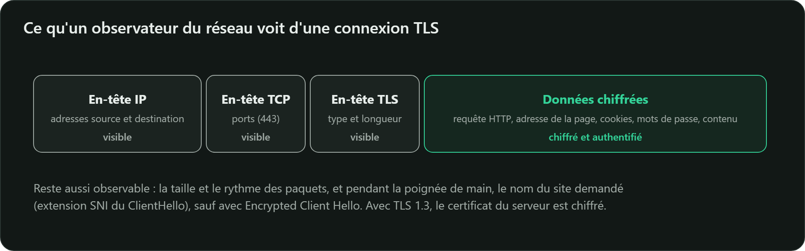

**TLS** (*Transport Layer Security*) protège la plupart des connexions d'Internet : le « s » de
`https`, mais aussi la messagerie (SMTP, IMAP), de nombreux VPN, les API et les connexions aux bases
de données.

## Trois garanties

| Garantie | Obtenue par |
|---|---|
| **Confidentialité** des données échangées | chiffrement symétrique authentifié : AES-GCM ou ChaCha20-Poly1305 |
| **Intégrité** : toute modification est détectée | le tag d'authentification de ces modes AEAD |
| **Authentification** du serveur (et, en option, du client) | certificat X.509 et signature |

TLS combine ainsi tout ce que vous avez vu dans les autres cours : échange de clés Diffie-Hellman
sur courbe elliptique, signatures, certificats, fonctions de hachage, dérivation de clés et
chiffrement symétrique.

Ce que TLS **ne cache pas** : les adresses IP, la taille et le rythme des échanges, et souvent le
nom du site demandé (l'extension SNI circule en clair, sauf avec *Encrypted Client Hello*).

## Une histoire mouvementée

| Version | Année | Statut aujourd'hui |
|---|---|---|
| SSL 2.0 / SSL 3.0 | 1995 / 1996 | interdits (attaque POODLE contre SSL 3.0 en 2014) |
| TLS 1.0 / TLS 1.1 | 1999 / 2006 | officiellement dépréciés par la RFC 8996 (2021) |
| TLS 1.2 | 2008 | acceptable s'il est **bien configuré** |
| **TLS 1.3** | 2018 (RFC 8446) | à privilégier |

TLS 1.3 a fait le ménage : suppression de l'échange de clés par chiffrement RSA (qui n'offre pas de
confidentialité persistante), des modes CBC (attaques BEAST, Lucky 13…), de RC4, de SHA-1 et MD5
dans les signatures, de la compression (attaque CRIME) et de la renégociation. Il ne reste que des
choix sûrs.

C'est exactement la recommandation R3 de l'ANSSI : **privilégier TLS 1.3 et accepter TLS 1.2** ;
et la R4 : ne pas utiliser SSLv2, SSLv3, TLS 1.0 ni TLS 1.1.

## Deux sous-protocoles principaux

- **Handshake** (poignée de main) : négocie les algorithmes, échange les clés et authentifie le
  serveur. C'est la partie asymétrique, celle que concerne la menace quantique.
- **Record** : découpe, chiffre et authentifie les données avec les clés symétriques établies
  pendant la poignée de main.
