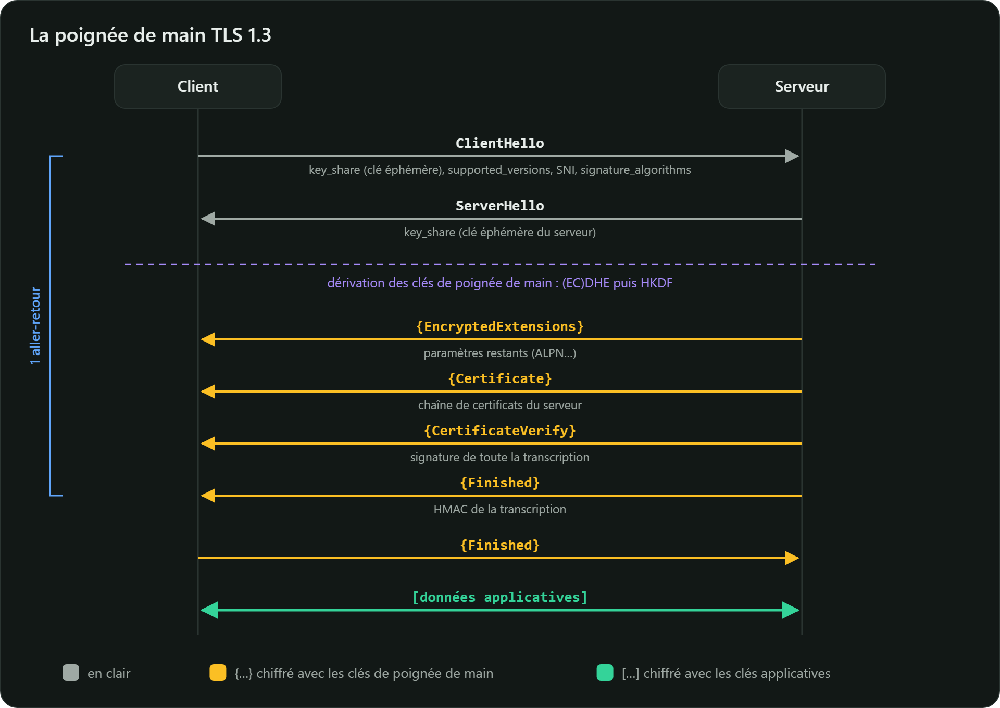

TLS 1.3 établit une connexion sécurisée en **un seul aller-retour** (1-RTT), contre deux pour
TLS 1.2.

## Étape par étape

1. **ClientHello** : le client envoie un aléa de 32 octets, les suites qu'il accepte, les
   algorithmes de signature, la version (`supported_versions` : TLS 1.3), le nom du serveur (SNI)
   et, **d'emblée**, une ou plusieurs clés publiques éphémères (`key_share`) : il parie sur le
   groupe que le serveur choisira. Si le pari échoue, le serveur répond `HelloRetryRequest`, au prix
   d'un aller-retour supplémentaire.
2. **ServerHello** : le serveur choisit la suite et le groupe, et envoie **sa** clé publique
   éphémère. Les deux côtés calculent le secret (EC)DHE et en dérivent les **clés de poignée de
   main**. Tout ce qui suit est **chiffré**, y compris le certificat du serveur, qui circulait en
   clair avec TLS 1.2.
3. **EncryptedExtensions** : les autres paramètres, par exemple le protocole applicatif choisi
   (ALPN : `h2`, `http/1.1`).
4. **Certificate** : la chaîne de certificats du serveur.
5. **CertificateVerify** : une **signature**, avec la clé privée du certificat, de l'empreinte de
   tous les messages échangés jusque-là. Elle prouve que le serveur détient la clé, et que personne
   n'a modifié la négociation.
6. **Finished** : un HMAC de toute la transcription, calculé avec une clé dérivée du secret. Le
   client le vérifie, envoie son propre `Finished`, et les **clés applicatives** prennent le relais.

## Le calendrier des clés

Toutes les clés dérivent du secret partagé grâce à **HKDF** (fonction de dérivation construite sur
HMAC), en étapes successives liées à l'empreinte de la transcription :

$$\text{PSK ou } 0 \xrightarrow{\text{Extract}} \text{Early Secret} \xrightarrow{\text{Extract avec (EC)DHE}} \text{Handshake Secret} \xrightarrow{\text{Extract}} \text{Master Secret}$$

Chaque sens de communication (client vers serveur, serveur vers client) a ses propres clés et
vecteurs d'initialisation, et un message `KeyUpdate` permet de renouveler les clés en cours de
session.

## Seulement cinq suites

| Suite | Chiffrement authentifié | Hachage de HKDF |
|---|---|---|
| `TLS_AES_128_GCM_SHA256` | AES-128-GCM | SHA-256 |
| `TLS_AES_256_GCM_SHA384` | AES-256-GCM | SHA-384 |
| `TLS_CHACHA20_POLY1305_SHA256` | ChaCha20-Poly1305 | SHA-256 |
| `TLS_AES_128_CCM_SHA256` | AES-128-CCM | SHA-256 |
| `TLS_AES_128_CCM_8_SHA256` | AES-128-CCM, tag de 8 octets | SHA-256 |

La suite ne décrit plus que la partie symétrique. L'échange de clés (`x25519`, `secp256r1`,
`X25519MLKEM768`…) et la signature (`ecdsa_secp256r1_sha256`, `rsa_pss_rsae_sha256`, `ed25519`…)
se négocient séparément. Toutes les suites sont AEAD, et toutes les poignées de main complètes
utilisent un échange de clés éphémère : la **confidentialité persistante** est systématique.

## Reprise de session et 0-RTT

Après une première connexion, le serveur peut remettre un **ticket** contenant une clé
pré-partagée (PSK). À la reconnexion, le client peut envoyer des données **dès son premier message**
(0-RTT). C'est rapide, mais ces données peuvent être **rejouées** par un attaquant et ne bénéficient
pas de la confidentialité persistante. L'ANSSI recommande de ne pas transmettre de données 0-RTT
(R23) ; à défaut, réservez-les aux requêtes sans effet de bord.
