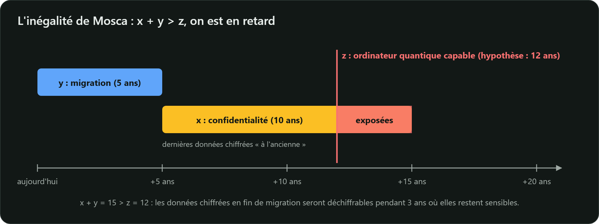

Un ordinateur quantique n'est pas « un ordinateur classique plus rapide » : il exploite la
superposition et l'intrication pour résoudre **certains** problèmes beaucoup plus vite. Deux
algorithmes concernent la cryptographie.

## L'algorithme de Shor (1994)

Il factorise un entier et calcule un logarithme discret en temps **polynomial**. Tomberaient donc :

| Mécanisme | Problème sous-jacent | Face à un ordinateur quantique suffisant |
|---|---|---|
| RSA (chiffrement, signature) | factorisation | cassé |
| Diffie-Hellman, DSA | logarithme discret | cassé |
| ECDH, X25519, ECDSA, Ed25519 | logarithme discret sur courbe elliptique | cassé |

Allonger les clés n'y change rien : le coût de l'attaque reste polynomial. **Toute** la
cryptographie asymétrique déployée aujourd'hui est concernée.

## L'algorithme de Grover (1996)

Il accélère la recherche exhaustive de façon **quadratique** : environ $\sqrt{N}$ étapes au lieu de
$N$. Sur le papier, une clé AES-128 n'offrirait plus que 64 bits de sécurité. En pratique,
l'accélération est bien moindre : les étapes de Grover sont **séquentielles**, se parallélisent mal,
et chacune serait très coûteuse.

L'ANSSI considère ainsi que des clés de 128 bits peuvent « être présumées suffisantes » face à
Grover à assez long terme, tout en recommandant des clés d'**au moins 192 bits** lorsqu'une sécurité
post-quantique est visée (*RecoPQTailleCléSym*), et des empreintes d'**au moins 384 bits**
(*RecoPQHachage*). AES-256 et SHA-384 règlent la question.

> **Le symétrique survit**, avec des tailles plus confortables. **L'asymétrique doit être remplacé.**

## Pourquoi s'en préoccuper dès maintenant ?

Aucun ordinateur quantique actuel ne menace RSA-2048 : les estimations publiées (Craig Gidney,
2025) évoquent de l'ordre d'un million de qubits physiques bruités fonctionnant pendant des jours,
loin des machines actuelles. Mais :

- **« Stocker maintenant, déchiffrer plus tard »** : un adversaire peut enregistrer aujourd'hui des
  échanges chiffrés et les déchiffrer dans 10 ou 15 ans. Toute donnée qui doit rester secrète
  longtemps (santé, défense, secrets industriels, données personnelles) est **déjà** exposée.
- **Les migrations sont longues** : inventaire, normes, produits, certificats, équipements
  embarqués… Une décennie n'est pas de trop.

L'**inégalité de Mosca** résume le problème. Si $x$ est la durée pendant laquelle vos données
doivent rester secrètes, $y$ la durée de votre migration et $z$ le délai avant l'arrivée d'un
ordinateur quantique capable de casser vos algorithmes, vous êtes en retard dès que :

$$x + y > z$$

C'est pourquoi le guide ANSSI des mécanismes cryptographiques (2026) recommande de **viser une
sécurité post-quantique** pour tout mécanisme dont l'usage est prévu au-delà du 1er janvier 2030,
ou exposé à un risque d'attaque rétroactive (*RecoSécuLongTerme*).

## La réponse : de nouveaux problèmes difficiles

La cryptographie **post-quantique** s'exécute sur nos ordinateurs actuels, mais repose sur des
problèmes que l'on pense difficiles même pour un ordinateur quantique :

| Famille | Problème difficile | Standards |
|---|---|---|
| Réseaux euclidiens | Module-LWE, Module-SIS | ML-KEM (FIPS 203), ML-DSA (FIPS 204), FN-DSA (Falcon, en cours de normalisation) |
| Fonctions de hachage | sécurité de la fonction de hachage | SLH-DSA (FIPS 205), LMS et XMSS (NIST SP 800-208) |
| Codes correcteurs d'erreurs | décodage d'un code aléatoire | HQC (retenu par le NIST en mars 2025), Classic McEliece |

À ne pas confondre avec la **cryptographie quantique** (distribution quantique de clés, QKD), qui
utilise des photons et un matériel dédié.
