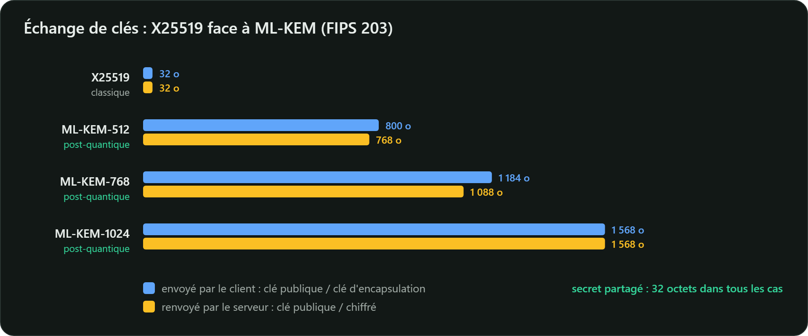

## Le problème LWE, en une équation

*Learning With Errors* (Oded Regev, 2005) : on publie une matrice aléatoire $A$ et le vecteur

$$b = A\,s + e \pmod q$$

où $s$ est secret et $e$ un **petit bruit** aléatoire. Sans le bruit, retrouver $s$ serait un
simple système linéaire (pivot de Gauss). Avec le bruit, on ne connaît aucun algorithme efficace,
ni classique ni quantique : le problème se ramène à trouver des vecteurs courts dans un réseau
euclidien de grande dimension.

**ML-KEM** (*Module-Lattice-based Key-Encapsulation Mechanism*, issu de CRYSTALS-Kyber) utilise une
variante structurée, **Module-LWE** : les coefficients de $A$, $s$ et $e$ sont des polynômes de
degré inférieur à $n = 256$, à coefficients modulo $q = 3329$. Cette structure rend les clés compactes
et les calculs très rapides.

## Un KEM, pas un Diffie-Hellman

Un mécanisme d'encapsulation de clés (KEM) comporte trois opérations :

| Opération | Qui | Résultat |
|---|---|---|
| `KeyGen()` | Bob | une clé d'encapsulation $ek$ (publique) et une clé de décapsulation $dk$ (privée) |
| `Encaps(ek)` | Alice | un secret partagé $K$ de 32 octets **et** un chiffré $c$, envoyé à Bob |
| `Decaps(dk, c)` | Bob | le même secret $K$ |

Contrairement à Diffie-Hellman, c'est Alice qui tire le secret et « l'enferme » dans $c$ ; les deux
parties ne jouent pas des rôles symétriques.

## Les trois jeux de paramètres

| | Catégorie de sécurité NIST | $k$ | Clé d'encapsulation | Clé de décapsulation | Chiffré | Secret |
|---|---|---|---|---|---|---|
| ML-KEM-512 | 1 (comparable à AES-128) | 2 | 800 o | 1 632 o | 768 o | 32 o |
| **ML-KEM-768** | 3 (comparable à AES-192) | 3 | 1 184 o | 2 400 o | 1 088 o | 32 o |
| ML-KEM-1024 | 5 (comparable à AES-256) | 4 | 1 568 o | 3 168 o | 1 568 o | 32 o |

(FIPS 203, tableaux 2 et 3.) Comparez avec X25519 : 32 octets de clé publique. Le prix de la
sécurité post-quantique est surtout la **taille** des messages, pas la vitesse : ML-KEM est aussi
rapide que ECDH, voire plus.



Le guide ANSSI des mécanismes cryptographiques (2026) juge ML-KEM-512 conforme **à condition de
l'hybrider** avec un mécanisme classique, et précise qu'« il est toutefois préférable d'utiliser le
niveau de sécurité supérieur, ML-KEM-768 ». Utilisé **sans hybridation**, ML-KEM n'est pas conforme,
quel que soit le jeu de paramètres.

## Essayez avec OpenSSL 3.5

```bash
# Bob génère sa paire de clés
openssl genpkey -algorithm ML-KEM-768 -out bob-kem.key
openssl pkey -in bob-kem.key -pubout -out bob-kem.pub

# Alice encapsule un secret avec la clé publique de Bob
openssl pkeyutl -encap -pubin -inkey bob-kem.pub -out chiffre.bin -secret secret-alice.bin

# Bob décapsule
openssl pkeyutl -decap -inkey bob-kem.key -in chiffre.bin -secret secret-bob.bin

cmp secret-alice.bin secret-bob.bin && echo "même secret"
wc -c chiffre.bin secret-alice.bin     # 1088 et 32 octets
```

## En Java

Le JDK intègre ML-KEM depuis **Java 24** (JEP 496), à travers l'API `javax.crypto.KEM` :

```java
KeyPair bob = KeyPairGenerator.getInstance("ML-KEM-768").generateKeyPair();

// Alice
KEM.Encapsulated capsule = KEM.getInstance("ML-KEM").newEncapsulator(bob.getPublic()).encapsulate();
byte[] chiffre = capsule.encapsulation();   // 1088 octets, à envoyer à Bob
SecretKey secretAlice = capsule.key();

// Bob
SecretKey secretBob = KEM.getInstance("ML-KEM").newDecapsulator(bob.getPrivate()).decapsulate(chiffre);
```
