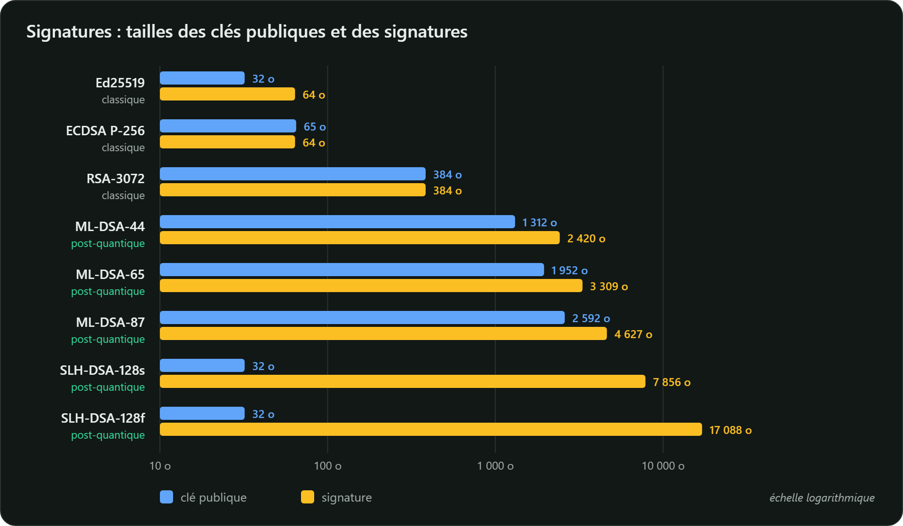

## ML-DSA (FIPS 204)

Issu de CRYSTALS-Dilithium, **ML-DSA** repose lui aussi sur les réseaux euclidiens modulaires
(Module-LWE et Module-SIS). Le signataire calcule une signature candidate et **la rejette pour
recommencer** si elle risquait de révéler de l'information sur sa clé privée : c'est le paradigme
« Fiat-Shamir avec rejets ».

| (en octets) | Clé publique | Clé privée | Signature |
|---|---|---|---|
| ML-DSA-44 | 1 312 | 2 560 | 2 420 |
| **ML-DSA-65** | 1 952 | 4 032 | 3 309 |
| ML-DSA-87 | 2 592 | 4 896 | 4 627 |

(FIPS 204, tableau 2.)

## SLH-DSA (FIPS 205)

Issu de SPHINCS+, **SLH-DSA** ne repose **que** sur la sécurité d'une fonction de hachage (SHA-2 ou
SHAKE) : c'est l'hypothèse la plus conservatrice qui soit. En contrepartie, ses signatures sont
volumineuses et lentes à produire.

| | Clé publique | Signature |
|---|---|---|
| SLH-DSA-SHA2-128s (*small*) | 32 octets | 7 856 octets |
| SLH-DSA-SHA2-128f (*fast*) | 32 octets | 17 088 octets |
| SLH-DSA-SHA2-256s | 64 octets | 29 792 octets |

(FIPS 205, tableau 2.) Les variantes *s* produisent des signatures plus petites, les variantes *f*
signent plus vite.

## La position de l'ANSSI

- **SLH-DSA** respecte à la fois les règles classiques et post-quantiques, puisqu'il repose sur une
  fonction de hachage conforme : il « peut donc être utilisé tel quel après 2030 ».
- **ML-DSA** doit être **hybridé** avec une signature classique conforme (ECDSA, RSA-PSS…). Le guide
  donne un exemple : signer le message avec ML-DSA, puis signer le couple (message, signature) avec
  le mécanisme classique.

Les signatures à base de hachage **avec état** (LMS, XMSS, NIST SP 800-208) sont plus compactes,
mais un état ne doit **jamais** être réutilisé : on les réserve à des usages très contrôlés, comme la
signature de micrologiciels.

## Comparaison

| | Clé publique | Signature | Résiste au quantique |
|---|---|---|---|
| Ed25519 | 32 o | 64 o | non |
| ECDSA P-256 | 33 à 65 o | 64 o (≈ 72 en DER) | non |
| RSA-3072 | 384 o | 384 o | non |
| ML-DSA-65 | 1 952 o | 3 309 o | oui |
| SLH-DSA-SHA2-128s | 32 o | 7 856 o | oui |



Une poignée de main TLS transporte plusieurs signatures et clés publiques (certificat du serveur,
intermédiaire, `CertificateVerify`…) : le surcoût se compte en kilooctets par connexion. C'est l'un
des grands chantiers de la migration.

## Essayez avec OpenSSL 3.5

```bash
openssl genpkey -algorithm ML-DSA-65 -out mldsa.key
openssl pkey -in mldsa.key -pubout -out mldsa.pub
openssl pkeyutl -sign -inkey mldsa.key -rawin -in message.txt -out signature.bin
wc -c signature.bin                                  # 3309 octets
openssl pkeyutl -verify -pubin -inkey mldsa.pub -rawin -in message.txt -sigfile signature.bin

openssl genpkey -algorithm SLH-DSA-SHA2-128s -out slh.key
openssl pkeyutl -sign -inkey slh.key -rawin -in message.txt -out signature-slh.bin
wc -c signature-slh.bin                              # 7856 octets
```

En Java, ML-DSA est disponible depuis **Java 24** (JEP 497) : `Signature.getInstance("ML-DSA")`,
avec une paire générée par `KeyPairGenerator.getInstance("ML-DSA-65")`.
