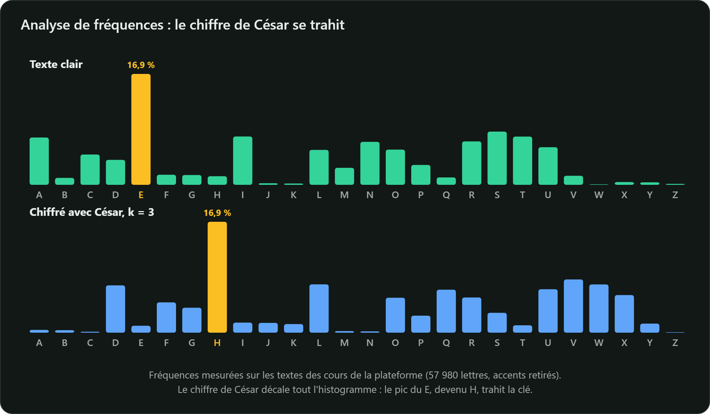

César décalait chaque lettre de trois rangs : `A → D`, `B → E`… Avec un alphabet de 26 lettres :

$$c_i = (m_i + k) \bmod 26$$

```python
def cesar(texte: str, k: int) -> str:
    resultat = []
    for car in texte.upper():
        if car.isalpha():
            resultat.append(chr((ord(car) - ord("A") + k) % 26 + ord("A")))
        else:
            resultat.append(car)
    return "".join(resultat)

print(cesar("ATTAQUE A L AUBE", 3))  # DWWDTXH D O DXEH
```

## Pourquoi c'est cassé

1. **Espace de clés minuscule** : 25 décalages utiles, que l'on essaie tous en une fraction de seconde.
2. **Fréquences conservées** : en français, `E` est la lettre la plus fréquente (environ 15 %).
   La lettre la plus fréquente du message chiffré trahit donc le décalage.



Même une substitution quelconque, avec $26! \approx 4 \times 10^{26}$ clés possibles, tombe
par **analyse de fréquences** : une grande clé ne suffit pas, le chiffré doit aussi ressembler à du hasard.
