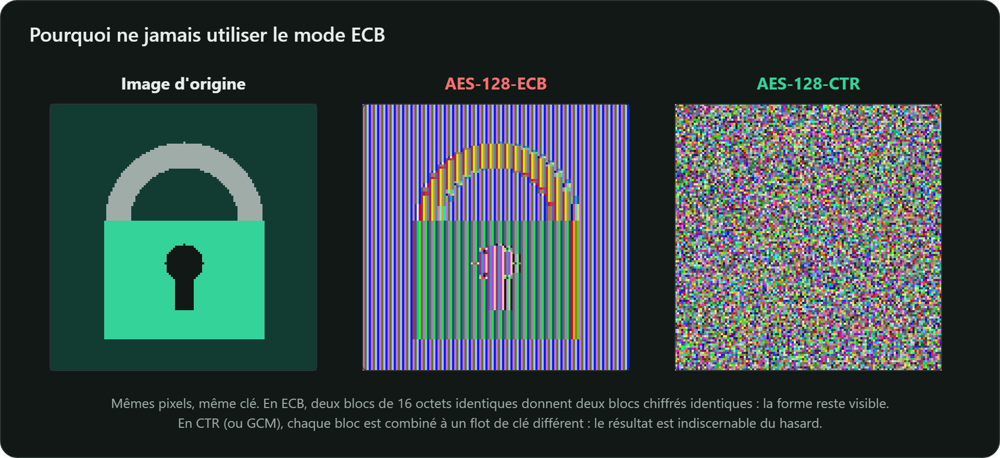

## 1. Réutiliser un nonce avec GCM ou CTR

Ces modes chiffrent par XOR avec un flot de clé $F$ qui ne dépend que de la clé et du nonce :

$$c_1 = m_1 \oplus F \qquad c_2 = m_2 \oplus F \quad\Longrightarrow\quad c_1 \oplus c_2 = m_1 \oplus m_2$$

L'attaquant obtient le XOR des deux messages clairs sans connaître la clé ; avec GCM, il peut en
plus fabriquer des messages que le destinataire acceptera. **Un nonce ne sert jamais deux fois avec la même clé.**

## 2. Utiliser ECB

Chaque bloc est chiffré indépendamment : les motifs du message restent visibles (le célèbre « pingouin ECB »).
Voici la même expérience, réalisée avec un vrai chiffrement AES-128 sur l'image d'un cadenas :

## 3. Oublier l'authentification

CBC ou CTR seuls garantissent la confidentialité, pas l'intégrité : un attaquant peut modifier le chiffré
(attaques par *padding oracle* sur CBC). Préférez un mode authentifié comme GCM.

## 4. Dériver la clé d'un mot de passe avec un simple hachage

`SHA-256(motDePasse)` se calcule des milliards de fois par seconde sur une carte graphique.
Utilisez une fonction de dérivation lente et salée : **Argon2id**, scrypt ou PBKDF2.
