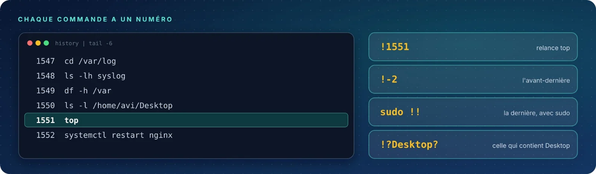

Chaque commande tapée est mémorisée et numérotée. Ces quatre raccourcis la retrouvent et la relancent
instantanément : **par son numéro**, **par sa position**, **en entier**, ou **par un mot** qu'elle contient.

| Fiche | Syntaxe | Rôle |
|:-:|:--|:--|
| 01 | `!n` | Réexécuter une commande par son numéro |
| 02 | `!-n` | Rappeler une commande par sa position |
| 03 | `!!` | Répéter la dernière commande |
| 04 | `!chaîne` | Rappeler par le début ou le contenu |
