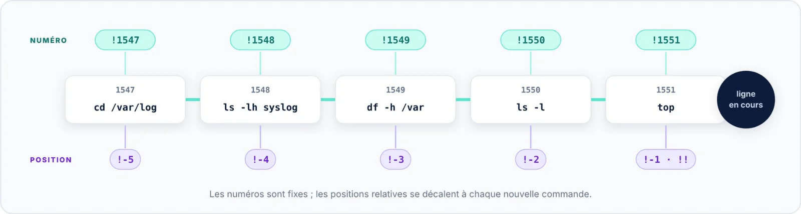

| 🎯 Objectif | 🖥️ Contexte | 📶 Niveau |
|:--|:--|:--|
| Relancer l'une des dernières commandes | Terminal interactif | 🔵 Pratique |

Pas besoin de connaître le numéro : `!-1` désigne la dernière commande exécutée (comme `!!`), `!-2`
l'avant-dernière, `!-3` celle d'avant, et ainsi de suite.



```bash title="bash"
$ cd /var/log
$ ls -lh syslog
$ df -h /var
$ !-3                           # trois commandes en arrière
cd /var/log
```

> [!WARNING] Des références qui bougent
> Une position relative est recalculée à chaque nouvelle commande : `!-3` ne désigne plus la même ligne
> une commande plus tard. Pour répéter plusieurs fois la même commande, préférez son numéro (fiche 01).
> En cas de doute, ajoutez `:p` pour afficher sans exécuter (fiche 09).
