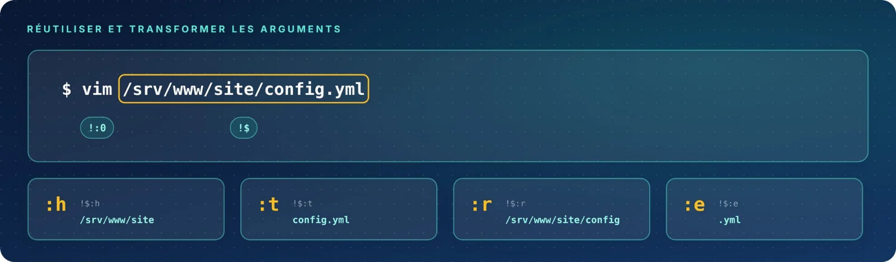

Les arguments des commandes précédentes — chemins longs, listes de fichiers — sont réutilisables à la
demande : **en entier**, **un par un**, ou **transformés**. Et une faute de frappe se corrige en une ligne.

| Fiche | Syntaxe | Rôle |
|:-:|:--|:--|
| 05 | `!$` · `!^` · `!*` | Réutiliser les arguments précédents |
| 06 | `!:n` | Choisir un argument ou une plage |
| 07 | `^ancien^nouveau^` | Corriger une faute de frappe |
| 08 | `:h` · `:t` · `:r` · `:e` | Découper un chemin de fichier |
