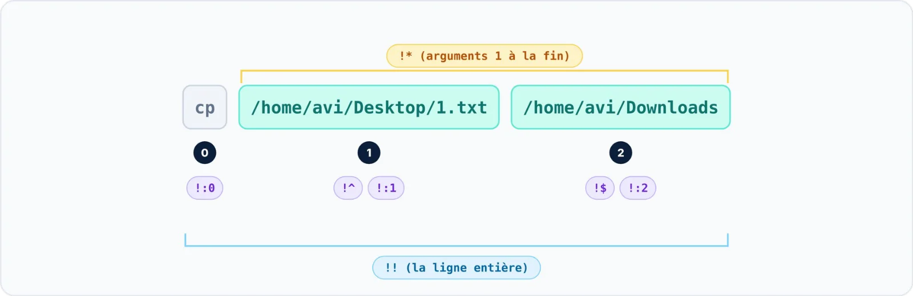

| 🎯 Objectif | 🖥️ Contexte | 📶 Niveau |
|:--|:--|:--|
| Extraire exactement la partie utile | Terminal interactif | 🔵 Pratique |

Les **désignateurs de mots** sélectionnent un mot par sa position. Le mot 0 est le nom de la commande,
le mot 1 le premier argument, et ainsi de suite.



```bash title="bash"
$ cp /home/avi/Desktop/1.txt /home/avi/Downloads
$ echo "Source : !^"
echo "Source : /home/avi/Desktop/1.txt"
Source : /home/avi/Desktop/1.txt
$ echo "Destination : !cp:2"
echo "Destination : /home/avi/Downloads"
Destination : /home/avi/Downloads
```

| Désignateur | Mot(s) repris |
|:--|:--|
| `!:2` | Le deuxième argument de la commande précédente |
| `!:2-4` | Les arguments 2 à 4 |
| `!:3*` | Les arguments 3 jusqu'au dernier (comme `!:3-$`) |
| `!:2-` | Les arguments 2 jusqu'à l'avant-dernier |
| `!cp:2` | Le deuxième argument de la dernière commande commençant par `cp` |

> [!IMPORTANT] Correction
> L'article d'origine indiquait que `!:3*` réutilise « les arguments 2 à 4 » : c'est inexact. `!:3*`
> prend tous les arguments **à partir du troisième**. Si la commande en compte moins de trois, Bash répond
> « bad word specifier ».
