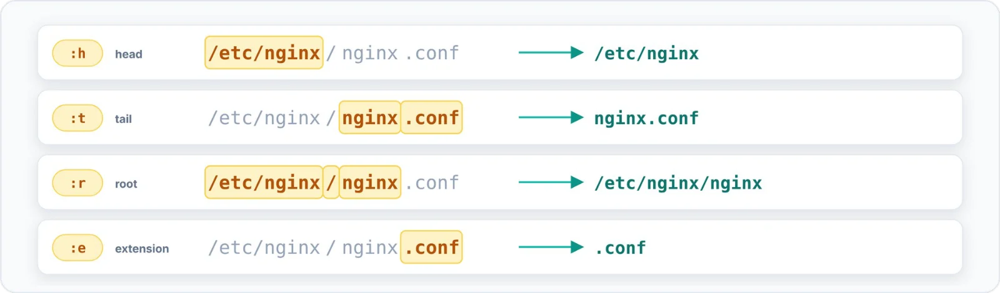

| 🎯 Objectif | 🖥️ Contexte | 📶 Niveau |
|:--|:--|:--|
| Extraire répertoire, nom ou extension | Terminal interactif | 🟣 Avancé |

Les **modificateurs** transforment le mot rappelé. Dans le feu de l'action, ils remplacent
avantageusement `dirname` et `basename`.



```bash title="bash"
$ ls -l /etc/nginx/nginx.conf
$ echo !$:h !$:t !$:r !$:e
echo /etc/nginx nginx.conf /etc/nginx/nginx .conf
/etc/nginx nginx.conf /etc/nginx/nginx .conf
```

Une combinaison très utile : modifier un fichier, puis se placer dans son répertoire.

```bash title="bash"
$ vim /srv/www/example.com/config/settings.yml
$ cd !$:h
cd /srv/www/example.com/config
```

> [!IMPORTANT] Combinaisons et correction
> Les modificateurs se combinent avec n'importe quel événement : `!!:$:t` donne le nom de fichier du
> dernier argument de la commande précédente, `!1551:$:h` le répertoire du dernier argument de
> l'événement 1551. L'article d'origine annonçait `:e` → « conf » : Bash conserve en réalité le point
> (`.conf`).
