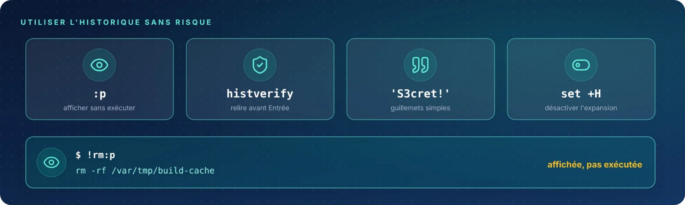

L'expansion d'historique s'exécute **immédiatement** : un `!rm` mal ciblé peut coûter cher. Trois réflexes
rendent son usage sûr : **prévisualiser**, **protéger** les textes qui contiennent un `!`, et **ne jamais
compter** sur elle dans un script.

| Fiche | Syntaxe | Rôle |
|:-:|:--|:--|
| 09 | `:p` | Prévisualiser avant d'exécuter |
| 10 | `set +H` | Éviter l'erreur « event not found » |
| 11 | `histexpand` | Historique et scripts : ce qui marche |
