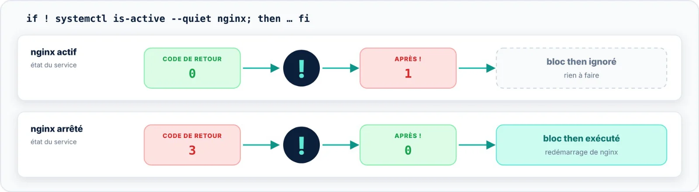

| 🎯 Objectif | 🖥️ Contexte | 📶 Niveau |
|:--|:--|:--|
| Réagir à un échec de façon lisible | Terminal et scripts | 🟢 Essentiel |

Placé devant une commande, `!` inverse son **code de retour** : un succès (0) devient un échec, un échec
devient un succès. C'est la façon la plus lisible d'écrire « si ceci ne fonctionne pas, alors… ».



```bash title="surveiller.sh"
#!/bin/bash
if ! systemctl is-active --quiet nginx; then
    echo "nginx est arrêté : redémarrage..."
    systemctl restart nginx
fi

if ! command -v jq >/dev/null 2>&1; then
    echo "jq est requis mais n'est pas installé." >&2
    exit 1
fi
```

> [!NOTE] Avec `set -e`
> Une commande précédée de `!` ne provoque jamais l'arrêt d'un script lancé avec `set -e`, même si elle
> échoue. C'est voulu, mais à garder en tête lors du débogage.
