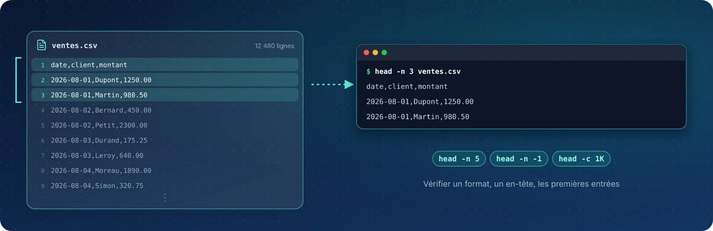

`head` affiche le **début** d'un fichier — par défaut ses 10 premières lignes. C'est le moyen le plus
rapide de vérifier un format, un en-tête de colonnes ou les premières entrées d'un fichier, sans ouvrir
d'éditeur.

| Fiche | Syntaxe | Rôle |
|:-:|:--|:--|
| 01 | `head` | Afficher les 10 premières lignes |
| 02 | `head -n` | Choisir le nombre de lignes |
| 03 | `head f1 f2` | Plusieurs fichiers à la fois |
| 04 | `head -c` | Compter en octets |
| 05 | `head -n -N` | Tout sauf les N dernières lignes |
