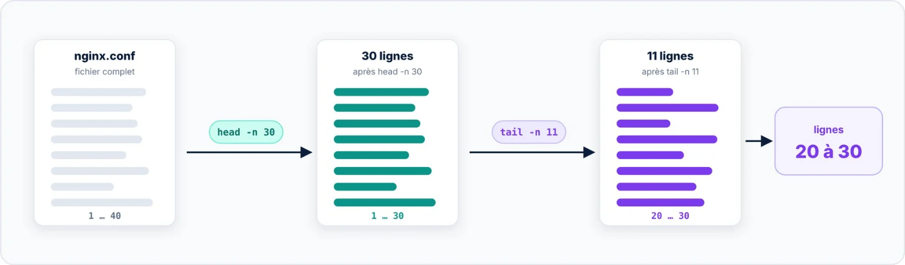

| 🎯 Objectif | 🐧 Disponibilité | 📶 Niveau |
|:--|:--|:--|
| Afficher les lignes A à B d'un fichier | Toutes distributions (GNU coreutils) | 🔵 Pratique |

Pour extraire une plage, on enchaîne `head` et `tail`. Lignes 20 à 30 d'un fichier : `head -n 30` garde
les 30 premières lignes, puis `tail -n 11` en conserve les 11 dernières.



```bash title="bash"
$ head -n 30 /etc/nginx/nginx.conf | tail -n 11
        types_hash_max_size 2048;
        # server_tokens off;

        # server_names_hash_bucket_size 64;
        # server_name_in_redirect off;

        include /etc/nginx/mime.types;
        default_type application/octet-stream;

        ##
        # SSL Settings
```

Les lignes vides comptent : le résultat contient bien 11 lignes, même si certaines sont vides. Dans un
script, `sed` ou `awk` sont plus directs :

```bash title="bash"
$ sed -n '20,30p' /etc/nginx/nginx.conf
# Variante rapide sur un très gros fichier : s'arrêter après la ligne 30
$ sed -n '20,30p;30q' /etc/nginx/nginx.conf
$ awk 'NR>=20 && NR<=30' /etc/nginx/nginx.conf
```

> [!TIP] Formule générale
> Lignes A à B : `head -n B fichier | tail -n (B − A + 1)`, ou plus simplement `sed -n 'A,Bp' fichier`.
