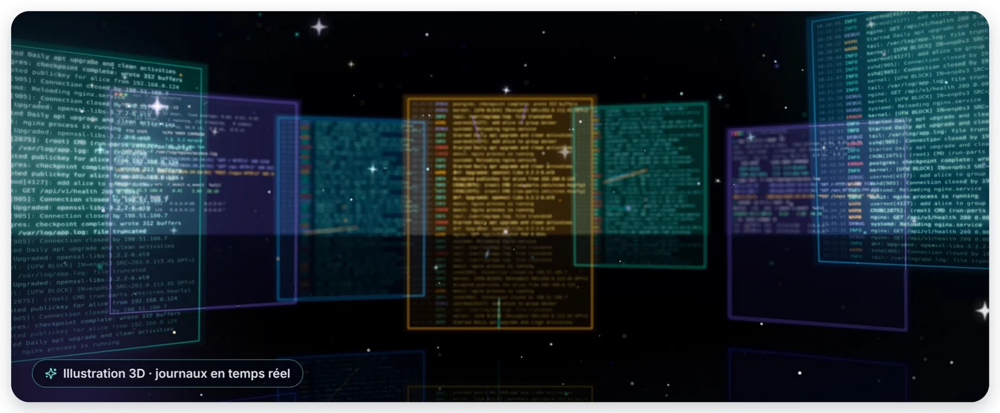

`head`, `tail` et `cat` paraissent élémentaires, mais leurs options en font de véritables **outils
d'analyse**. Bien maîtrisés, ils permettent d'inspecter une configuration, d'examiner le début ou la fin
d'un journal, de suivre un service en direct ou d'assembler des fichiers — en quelques secondes, sans
quitter le terminal.

## Les réflexes à retenir

- `head` ou `tail` **avant** d'ouvrir un gros fichier dans un éditeur ;
- `tail -F`, et non `-f`, pour toute surveillance longue ;
- `journalctl -u <service> -f` lorsque le service écrit dans journald ;
- `cat -A` dès qu'un script ou une configuration se comporte de façon inexplicable ;
- `>>` pour ajouter, `>` pour remplacer — et `sudo tee` pour les fichiers système ;
- `sed -n 'A,Bp'` pour extraire une plage de lignes dans un script.

> [!TIP] Pour aller plus loin
> `less` pour naviguer dans un gros fichier, `grep` pour filtrer, `awk` pour extraire des colonnes,
> `wc -l` pour compter : avec `head`, `tail` et `cat`, ils forment la boîte à outils texte de tout
> administrateur.
