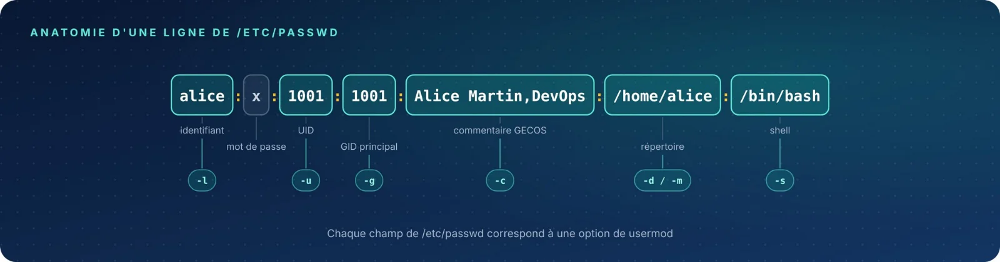

Commentaire, répertoire personnel, nom de connexion et shell : ces attributs vivent dans `/etc/passwd`.
Certains sont anodins, d'autres — renommer un compte ou déplacer son répertoire — demandent une vraie
préparation.

| Fiche | Syntaxe | Rôle |
|:-:|:--|:--|
| 01 | `usermod -c` | Mettre à jour le commentaire GECOS |
| 02 | `usermod -d` | Changer seulement le chemin du répertoire |
| 03 | `usermod -d -m` | Déplacer le répertoire et son contenu |
| 04 | `usermod -l` | Renommer un compte |
| 05 | `usermod -s` | Changer le shell de connexion |
