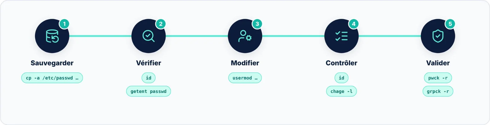

`usermod` paraît simple, mais il peut modifier presque tout ce qui compte dans un compte Linux : groupes, UID,
répertoire personnel, politique de mot de passe, shell, expiration, et même les identifiants subordonnés des
conteneurs sans root.

## Les réflexes à retenir

- Sauvegarder `passwd`, `shadow`, `group` et `gshadow` avant toute modification importante ;
- **Toujours `-aG`** pour ajouter un groupe — jamais `-G` seul sans le vouloir ;
- `-d -m` pour migrer un répertoire, `-d` seul uniquement si la destination est prête ;
- `-L` ne suffit pas pour neutraliser un compte : ajoutez `-e 1`, arrêtez les processus, désactivez les clés SSH ;
- `passwd` ou `chpasswd` plutôt que `-p` avec un mot de passe en clair ;
- Après chaque série de modifications : `sudo pwck -r` et `sudo grpck -r`.

> [!TIP] Pour aller plus loin
> Les commandes voisines à maîtriser ensuite : `userdel` (supprimer un compte), `gpasswd` (administrer les
> groupes), `chage` (politique de mot de passe) et `passwd -e` (forcer le changement du mot de passe à la
> prochaine connexion).
