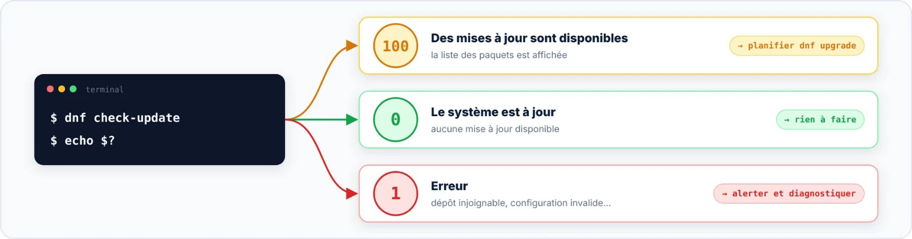

| 🎯 Objectif | 🔑 Privilèges | 📶 Niveau |
|:--|:--|:--|
| Savoir ce qui sera mis à jour, sans rien modifier | Aucun | 🟢 Essentiel |

`dnf check-update` rafraîchit les métadonnées si nécessaire et liste les paquets pour lesquels une version plus
récente existe. Elle **ne modifie rien** : c'est la commande à lancer avant toute mise à jour en production.

```bash title="bash"
$ dnf check-update
Last metadata expiration check: 0:03:12 ago on Tue 01 Sep 2026 10:02:11 AM UTC.

kernel.x86_64                 5.14.0-570.42.1.el9_6          baseos
openssl.x86_64                1:3.2.2-6.el9_6.1              baseos
openssl-libs.x86_64           1:3.2.2-6.el9_6.1              baseos
$ echo $?
100
```



```bash title="verifier-maj.sh"
#!/bin/bash
dnf -q check-update > /tmp/maj.txt
case $? in
    100) echo "Mises à jour disponibles : $(grep -c . /tmp/maj.txt)" ;;
    0)   echo "Système à jour" ;;
    *)   echo "Erreur lors de la vérification" >&2 ; exit 1 ;;
esac
```

> [!TIP] Correctifs de sécurité seulement
> Sur RHEL et ses dérivés, `dnf check-update --security` ne liste que les correctifs de sécurité, grâce aux
> avis publiés par la distribution (*updateinfo*) ; `dnf updateinfo list --security` les détaille, avis par
> avis.
