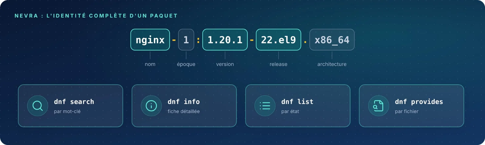

Avant d'installer quoi que ce soit, il faut trouver le bon paquet : par mot-clé, par fichier fourni ou par
état. Ces commandes **ne modifient rien** et ne demandent aucun privilège.

| Fiche | Commande | Rôle |
|:-:|:--|:--|
| 06 | `dnf search` | Rechercher un paquet par mot-clé |
| 07 | `dnf info` | Afficher le détail d'un paquet |
| 08 | `dnf list` | Lister les paquets selon leur état |
| 09 | `dnf provides` | Trouver le paquet qui fournit un fichier |
