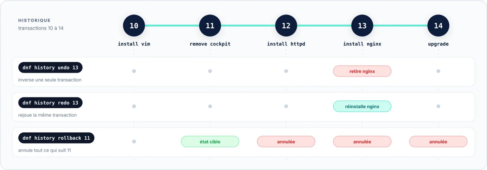

| 🎯 Objectif | 🔑 Privilèges | 📶 Niveau |
|:--|:--|:--|
| Revenir sur une opération précise | root (`sudo`) | 🟣 Avancé |

`dnf history undo` applique **l'inverse** d'une transaction : ce qu'elle avait installé est supprimé, ce qu'elle
avait supprimé est réinstallé, ce qu'elle avait mis à jour revient à la version précédente. `redo` rejoue la
même transaction.



```bash title="bash"
# Annuler l'installation de nginx (transaction 13)
$ sudo dnf history undo 13
# La rejouer à l'identique
$ sudo dnf history redo 13
# Annuler la dernière transaction, quelle qu'elle soit
$ sudo dnf history undo last
# Revenir à l'état du système juste après la transaction 11
$ sudo dnf history rollback 11
```

> [!WARNING] Limites
> Pour annuler une mise à jour, DNF doit retrouver l'ancienne version dans un dépôt ou dans le cache. Les
> dépôts de RHEL, Rocky Linux et AlmaLinux conservent les versions précédentes ; le dépôt *updates* de Fedora,
> non : l'annulation y échoue souvent. Quant à `rollback`, il annule **toutes** les transactions postérieures :
> à manier avec précaution.
