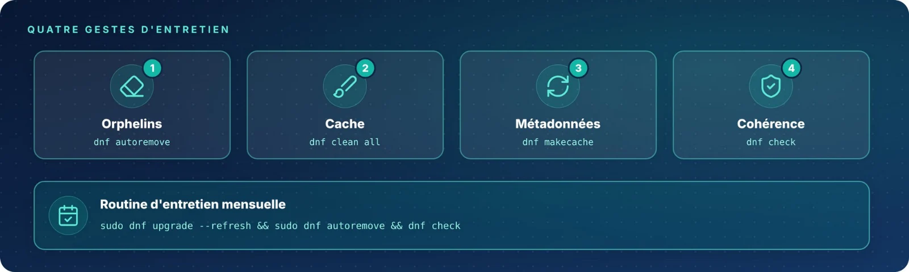

Un système sain s'entretient : supprimer les dépendances devenues inutiles, garder un cache propre et vérifier
régulièrement la cohérence de la base RPM et des fichiers installés.

| Fiche | Commande | Rôle |
|:-:|:--|:--|
| 18 | `dnf autoremove` | Supprimer les dépendances orphelines |
| 19 | `dnf clean` | Vider et reconstruire le cache |
| 20 | `dnf check` | Vérifier la cohérence de la base RPM |
