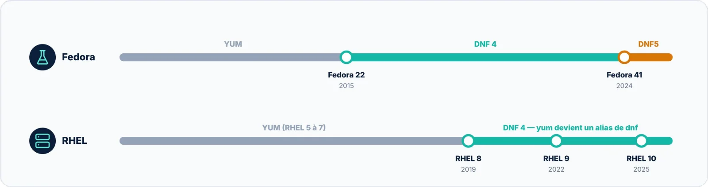

Depuis **Fedora 41** (octobre 2024), la commande `dnf` lance **DNF5**, une réécriture complète en C++ : plus
rapide, plus légère, avec une seule bibliothèque partagée par l'outil en ligne de commande et les interfaces
graphiques. RHEL 10 et ses dérivés restent, eux, sur DNF 4.



Bonne nouvelle : la grande majorité des commandes de ce guide fonctionnent **à l'identique** avec DNF5. Les
différences portent surtout sur la configuration des dépôts, l'affichage et quelques options.

## Les commandes en pratique

```bash title="bash"
$ sudo dnf5 install nginx
$ sudo dnf5 remove nginx
$ sudo dnf5 upgrade --refresh
$ dnf5 check-upgrade
$ dnf5 list --installed
$ dnf5 repo list --all
$ sudo dnf5 config-manager addrepo --from-repofile=https://exemple.org/app.repo
$ sudo dnf5 config-manager setopt epel.enabled=1
$ dnf5 history list
$ sudo dnf5 history undo 42
$ sudo dnf5 clean all
```

## Ce qui change au quotidien

| Sujet | DNF 4 | DNF5 |
|:--|:--|:--|
| Implémentation | Python, libdnf | C++, libdnf5 |
| Distributions | RHEL 8 à 10, Rocky, Alma, CentOS Stream | Fedora 41 et suivantes |
| Vérifier les mises à jour | `dnf check-update` | `dnf check-upgrade` (ancien nom accepté) |
| Lister les installés | `list installed` ou `--installed` | `list --installed` seulement |
| Lister les dépôts | `dnf repolist` | `dnf repo list` (ou `repolist`) |
| Ajouter un dépôt | `config-manager --add-repo` | `config-manager addrepo` |
| Activer un dépôt | `config-manager --set-enabled` | `config-manager setopt` |
| Marquer un paquet | `dnf mark install pkg` | `dnf mark user pkg` |
| Modules | Support complet | Support partiel (enable, disable, reset, list) |
| Cache | `/var/cache/dnf` | `/var/cache/libdnf5` |
| Journal | `/var/log/dnf.log` | `/var/log/dnf5.log` |

## Bon à savoir avant de migrer

- Sur Fedora 41 et suivantes, `dnf` **est** DNF5 : la commande `dnf5` n'est qu'un autre nom. L'ancien DNF reste
  disponible sous le nom `dnf4` pour la transition ;
- Les scripts qui analysent la sortie de DNF (colonnes, libellés) doivent être revérifiés : l'affichage a
  changé ;
- Les greffons de DNF 4 (`dnf-plugins-core`) ne fonctionnent pas avec DNF5, qui a ses propres extensions
  (`dnf5-plugins`) ;
- Les listes de fichiers des dépôts ne sont plus téléchargées par défaut : DNF5 les récupère à la demande, par
  exemple pour `dnf provides /chemin/fichier` ;
- Préférez dès aujourd'hui les formes compatibles avec les deux versions : `dnf list --installed` plutôt que
  `list installed`, `dnf upgrade` plutôt que `update`.

> [!TIP] Une seule habitude à prendre
> Écrivez vos procédures avec la syntaxe commune aux deux versions et ne réservez les formes propres à DNF5
> qu'à la configuration des dépôts (`config-manager addrepo` et `setopt`). Vos runbooks resteront valables sur
> RHEL comme sur Fedora.
