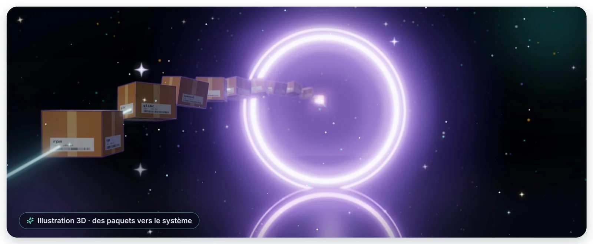
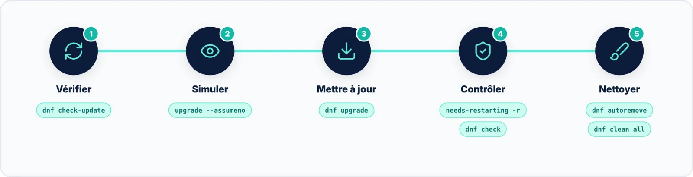

DNF est bien plus qu'un installateur : c'est un **outil de gestion du changement**. Chaque transaction est
calculée, présentée, signée, journalisée et, dans la plupart des cas, réversible. Utilisé avec méthode, il rend
la maintenance d'un parc Red Hat prévisible.

## Les réflexes à retenir

- Lire le résumé de transaction avant de répondre `y`, en particulier les sections « Removing » ;
- `dnf check-update` avant chaque mise à jour, et son code **100** dans vos scripts ;
- `dnf history` pour comprendre, `history undo` ou `downgrade` pour revenir en arrière ;
- **Jamais** `--nogpgcheck` ni `gpgcheck=0` en production ;
- Les identifiants de groupes et de dépôts plutôt que les noms affichés dans les scripts ;
- La syntaxe à tirets (`--installed`, `--available`) : elle fonctionne aussi avec DNF5.

> [!TIP] Pour aller plus loin
> Automatisez l'application des correctifs avec `dnf-automatic` (minuteur systemd `dnf-automatic.timer`) ;
> pour passer d'une version de Fedora à la suivante, utilisez `dnf system-upgrade`.
