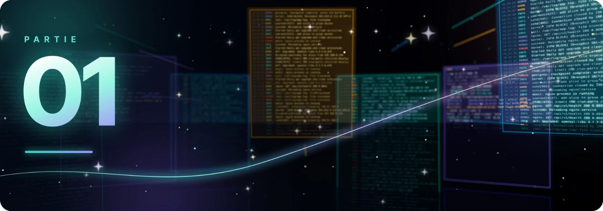

Avant de réparer, il faut comprendre ce que faisait le gestionnaire de paquets au moment de l'interruption :
chaque commande de réparation vient **compléter ou annuler une partie précise** de ce travail inachevé.

| Étape | Sujet | Rôle |
|:-:|:--|:--|
| 1.1 | Le verrou | Pourquoi un seul programme à la fois |
| 1.2 | États de dpkg | Paquets décompressés mais non configurés |
| 1.3 | Doublons RPM | Deux versions enregistrées pour un même paquet |
