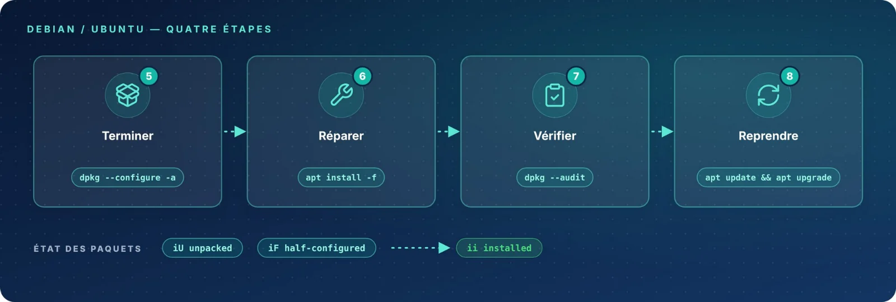

Une fois le verrou libéré, il reste à **terminer** l'installation des paquets restés en suspens, à **réparer**
les dépendances, puis à **vérifier** la cohérence de la base avant de **reprendre** la mise à jour.

| Étape | Commande | Rôle |
|:-:|:--|:--|
| 05 | `dpkg --configure -a` | Terminer les configurations interrompues |
| 06 | `apt install -f` | Réparer les dépendances |
| 07 | `dpkg --audit` | Vérifier la cohérence de la base |
| 08 | `apt update && apt upgrade` | Reprendre la mise à jour |
