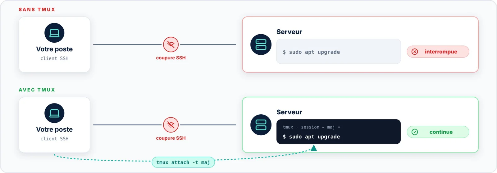

| 🎯 Objectif | 🐧 Systèmes | 🚦 Risque |
|:--|:--|:--|
| Ne plus perdre une mise à jour sur coupure SSH | Tous | ⚪ Aucun |

La plupart des mises à jour interrompues sont dues à une **coupure SSH**. Lancées dans tmux, elles se
poursuivent sur le serveur quel que soit l'état de votre connexion ; il suffit ensuite de se rattacher à la
session.



```bash title="bash"
$ tmux new -s maj
$ sudo apt upgrade                  # ou : sudo dnf upgrade
# Détacher volontairement : Ctrl+B, puis D
# Après reconnexion SSH : lister puis rattacher la session
$ tmux ls
$ tmux attach -t maj
```
