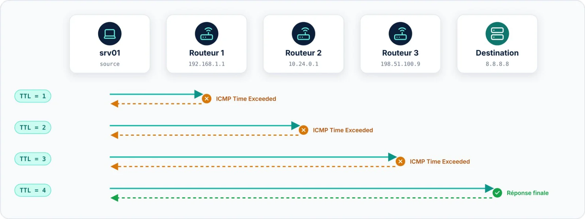

| 📦 Paquet | 🔑 Privilèges | 🏷️ Statut |
|:--|:--|:--|
| `traceroute` | Utilisateur (root pour les sondes `-I` et `-T`) | 🔵 Actif |

`traceroute` affiche chaque routeur (**saut**) traversé entre votre machine et une destination, avec le temps de
réponse de chacun. Il exploite le champ **TTL** des paquets IP : chaque routeur qui ramène le TTL à zéro renvoie
un message ICMP et révèle ainsi sa présence. C'est l'outil qui permet de localiser l'endroit précis où une
connexion se dégrade ou s'interrompt.



```bash title="bash"
$ traceroute -n 8.8.8.8
traceroute to 8.8.8.8 (8.8.8.8), 30 hops max, 60 byte packets
 1  192.168.1.1    0.487 ms  0.277 ms  0.269 ms
 2  10.24.0.1      1.846 ms  1.631 ms  1.553 ms
 3  * * *
 4  198.51.100.9   3.762 ms  3.683 ms  3.577 ms
 5  8.8.8.8        4.666 ms  4.869 ms  4.245 ms
```

Chaque ligne correspond à un saut ; les trois valeurs sont les temps de réponse de trois sondes successives. Les
astérisques `* * *` signifient que le routeur n'a pas répondu dans le délai imparti — souvent à cause d'un
filtrage ICMP — sans forcément indiquer une panne.

| Option | Effet |
|:--|:--|
| `-n` | Ne pas résoudre les noms d'hôtes (affichage plus rapide) |
| `-I` | Utiliser des sondes ICMP au lieu de paquets UDP |
| `-T -p 443` | Sondes TCP SYN vers un port : traverse mieux les pare-feu |
| `-m <n>` | Nombre maximal de sauts (30 par défaut) |

> [!TIP] Alternative
> `tracepath` fonctionne de manière similaire sans privilèges root et détermine en plus la MTU du chemin
> (*Path MTU*).
