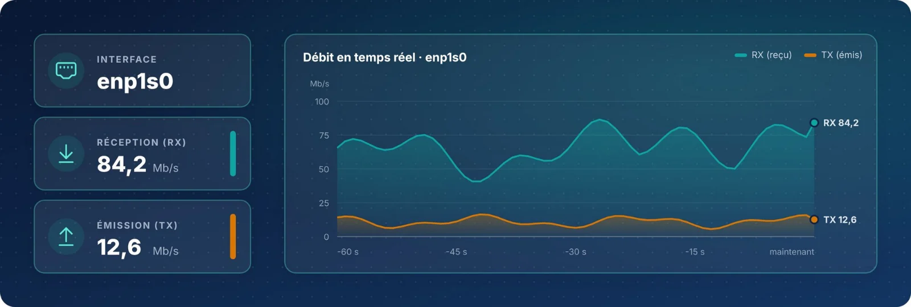

Mesurer la **bande passante consommée en temps réel** aide à repérer une saturation, un transfert anormal ou une
interface sous-dimensionnée, et à estimer le débit réellement disponible.

| Fiche | Commande | Rôle |
|:-:|:--|:--|
| 19 | `bmon` | Bande passante en temps réel |
