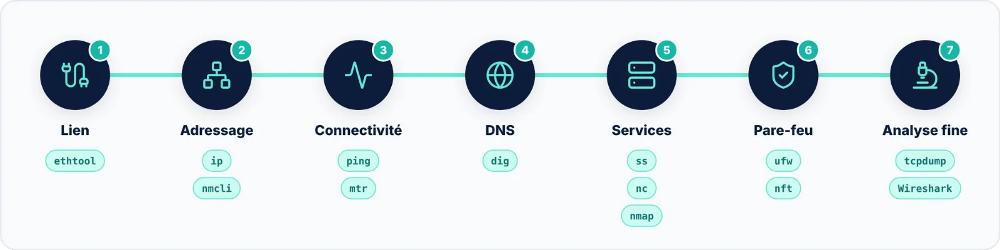

Ce cours a passé en revue les **22 outils** en ligne de commande les plus utilisés pour la gestion du réseau
sous Linux, classés par familles. Ils constituent le socle de compétences de tout administrateur système, et sont
tout aussi utiles aux administrateurs et ingénieurs réseau à temps plein.

La maîtrise de ces commandes repose sur trois principes : **privilégier les outils modernes** (`ip`, `ss`, `nmcli`,
nftables) tout en sachant lire les outils historiques encore présents sur de nombreux serveurs ; **procéder avec
méthode**, de la couche physique jusqu'à l'application ; et **agir avec prudence**, en particulier sur les pare-feu
et les serveurs distants.

## En résumé : la démarche de diagnostic

## Pour aller plus loin

- `man <commande>` : la documentation complète et officielle de chaque outil ;
- `<commande> --help` : un résumé rapide des options disponibles ;
- `tldr <commande>` : des exemples pratiques et concis (paquet `tldr`) ;
- Un laboratoire virtuel (VirtualBox, KVM, GNS3) pour s'exercer sans risque.
