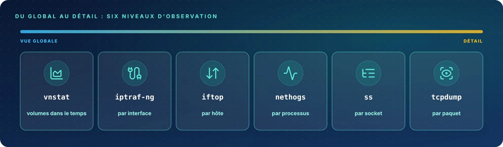

Du volume mensuel d'une interface jusqu'au contenu d'un paquet, chaque outil réseau travaille à un **niveau de
détail différent**. Choisir le bon niveau, c'est trouver la réponse en quelques secondes.

| Fiche | Outil | Rôle |
|:-:|:--|:--|
| 09 | `ss` (netstat) | Sockets, ports et connexions |
| 10 | `tcpdump` | Capturer et filtrer les paquets |
| 11 | `iftop` | La bande passante par hôte |
| 12 | `nethogs` | La bande passante par processus |
| 13 | `iptraf-ng` | Statistiques d'interface et trafic IP |
| 14 | `vnstat` | L'historique du trafic |
