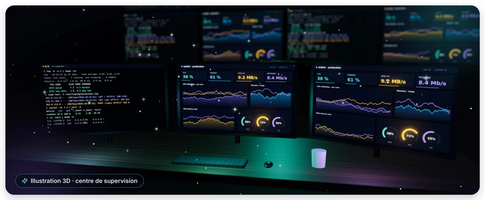
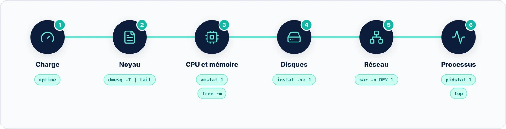

Surveiller un serveur Linux, ce n'est pas collectionner les outils : c'est **savoir lequel ouvrir** selon la
question posée, **lire correctement ses chiffres**, puis faire en sorte que la prochaine alerte arrive **avant
l'appel de l'utilisateur**.

## Les réflexes à retenir

- Charge moyenne **comparée au nombre de cœurs**, jamais lue seule ;
- Première ligne de `vmstat` ignorée ; `si`/`so` différents de zéro = pression mémoire ;
- **Latence** (`r_await`, `w_await`) plutôt que `%util` pour juger un SSD ou un NVMe ;
- `ss` à la place de `netstat`, `lsof +L1` quand le disque est plein sans raison ;
- **Historique activé** sur chaque serveur : sysstat, atop ou vnstat ;
- Tableaux de bord **jamais exposés sur Internet** : localhost, VPN ou tunnel SSH.

> [!TIP] Pour aller plus loin
> À l'échelle d'un parc, la pile **Prometheus** (avec `node_exporter`) et **Grafana** est devenue un standard pour
> l'historique et les alertes. Pour l'analyse fine des performances, explorez `perf` et les outils **eBPF**
> (`bpftrace`, collection bcc).
