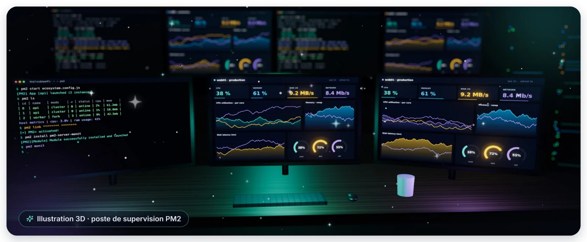

Une application Node.js en production doit rester en ligne jour et nuit. **PM2**, le gestionnaire de processus le
plus répandu de l'écosystème Node.js, la relance automatiquement en cas de panne, répartit la charge sur
plusieurs cœurs et conserve ses journaux. Il offre aussi tout le nécessaire pour savoir, à chaque instant,
comment elle se porte.

Ce cours montre comment superviser vos applications à **trois niveaux** : dans le **terminal**, avec les outils
intégrés à PM2 ; dans le **navigateur**, avec le tableau de bord web PM2 Plus ; et au niveau du **serveur**
lui-même, avec le module `pm2-server-monit`.

> [!IMPORTANT] Commandes rétablies et informations mises à jour
> La traduction automatique de l'article d'origine a francisé les commandes : « pm2 moniteur » pour `pm2 monit`,
> « lien pm2 » pour `pm2 link`, « pm2 déconnecter » pour `pm2 unlink`, « pm2 désinstaller » pour
> `pm2 uninstall`, « groupe de compartiments » pour *bucket*. Ce guide rétablit tout et actualise l'article, écrit
> en 2020 : la formule gratuite de PM2 Plus « jusqu'à 4 serveurs » n'existe plus, et PM2 en est aujourd'hui à la
> version 7.

## Objectifs du guide

- Lancer une application sous PM2 et lire son état en un coup d'œil ;
- Surveiller processeur, mémoire, journaux et métriques personnalisées depuis le terminal ;
- Relier un ou plusieurs serveurs au tableau de bord web PM2 Plus, puis les en détacher proprement ;
- Suivre les ressources du serveur (processeur, disque, mémoire, processus) avec `pm2-server-monit`.

## Public et environnement

Ce guide s'adresse aux développeurs et administrateurs qui déploient des applications Node.js sous Linux
(Debian, Ubuntu, RHEL, Rocky Linux, AlmaLinux…). Les exemples ont été vérifiés avec **PM2 7.0.4** et
**Node.js 22**. PM2 7 déclare une compatibilité à partir de Node.js 18 : privilégiez une version LTS encore
maintenue.

## Conventions utilisées

| Notation | Signification |
|:--|:--|
| `$ commande` | Commande tapée par l'utilisateur qui exécute PM2 |
| `# texte` | Commentaire explicatif dans un bloc de code |
| `<clé_secrète>` | Valeur à remplacer par la vôtre |
| 💻 Terminal · 🌐 Web · 🧩 Code | Où se passe l'action : ligne de commande, navigateur ou code de l'application |
| 🟢 Essentiel · 🔵 Pratique · 🟣 Avancé | Niveau de chaque fiche |

> [!WARNING] Root ou utilisateur dédié ?
> L'article d'origine exécute tout en root. En production, faites plutôt tourner PM2 sous un **utilisateur dédié**
> (par exemple `deploy`) : chaque utilisateur possède son propre démon PM2 et sa propre liste de processus,
> rangés dans `~/.pm2`. Un `sudo pm2 list` affiche donc la liste de root, pas la vôtre.
