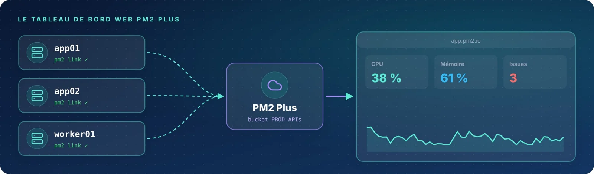

Dès que plusieurs serveurs entrent en jeu, ou qu'il faut garder un historique et recevoir des alertes, le
**tableau de bord web** prend le relais. Quatre étapes : créer un compte, relier le serveur, lire le tableau de bord
et détacher proprement.

| Fiche | Étape | Rôle |
|:-:|:--|:--|
| 07 | app.pm2.io | Créer un compte et un bucket |
| 08 | `pm2 link` | Relier le serveur à PM2 Plus |
| 09 | Tableau de bord | Lire le tableau de bord web |
| 10 | `pm2 unlink` | Détacher un serveur |
