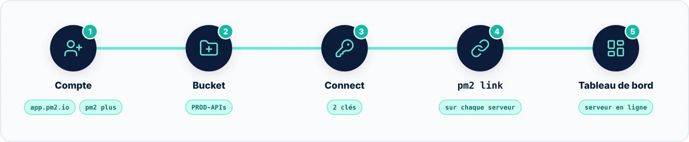

| 🎯 Objectif | 🧭 Contexte | 📶 Niveau |
|:--|:--|:--|
| Préparer l'espace de supervision | 🌐 Navigateur · app.pm2.io | 🔵 Pratique |

**PM2 Plus** est le service de supervision en ligne des créateurs de PM2. Créez un compte sur **app.pm2.io**, ou
tapez `pm2 plus` dans le terminal pour suivre l'assistant.

Une fois connecté, créez un **bucket** : c'est l'espace qui regroupe les serveurs et applications d'un même
projet, et auquel s'attache l'abonnement. Donnez-lui un nom parlant, par exemple `PROD-APIs`, puis validez avec
**Create**. Le bouton **Connect** affiche alors la commande `pm2 link` à copier, avec vos deux clés.

> [!IMPORTANT] L'offre a changé depuis 2020
> L'article d'origine annonçait une formule gratuite jusqu'à 4 serveurs. D'après la page Tarifs de PM2 consultée
> en octobre 2026, **PM2 Plus ne propose plus de formule gratuite** : les abonnements démarrent à 39 USD par mois,
> et un essai est possible sur demande auprès de l'équipe commerciale. PM2 lui-même, `pm2 monit` et
> `pm2-server-monit` restent **gratuits et open source**.

> [!CAUTION] Des clés à protéger
> La **clé secrète** donne accès à votre bucket : ne la publiez jamais dans un dépôt de code. En cas de fuite,
> régénérez-la depuis les paramètres du bucket.
