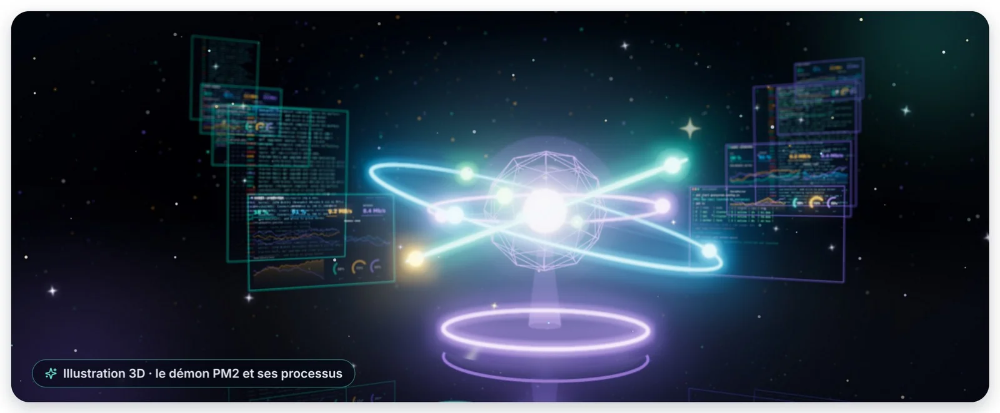
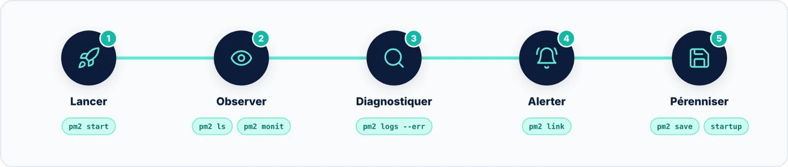

Superviser une application Node.js avec PM2, c'est combiner **trois regards** : le **terminal** pour l'instant
présent, le **tableau de bord web** pour l'historique et les alertes, et **pm2-server-monit** pour la santé de la
machine. Quelques commandes suffisent à ne plus rien laisser passer.

## Les réflexes à retenir

- `pm2 ls` d'abord : le statut et le compteur ↺ disent presque tout ;
- `pm2 logs --err` dès qu'un processus passe en `errored` ;
- `pm2 monit` pour un diagnostic en direct sur un serveur ;
- `pm2 link` pour plusieurs serveurs, l'historique et les alertes — `pm2 unlink` pour en sortir ;
- `pm2 install pm2-server-monit` pour surveiller aussi la machine ;
- `pm2 save` et `pm2 startup` pour que tout survive à un redémarrage.

> [!TIP] Pour aller plus loin
> PM2 7 sait aussi produire des traces **OpenTelemetry** : `pm2 install-otel` installe les paquets nécessaires, puis
> l'option `--trace` de `pm2 start` active le traçage des transactions. Des modules communautaires exportent par
> ailleurs les métriques PM2 vers Prometheus et Grafana : vérifiez qu'ils sont maintenus avant de les adopter.
